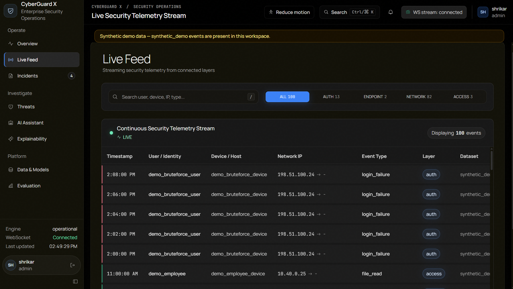
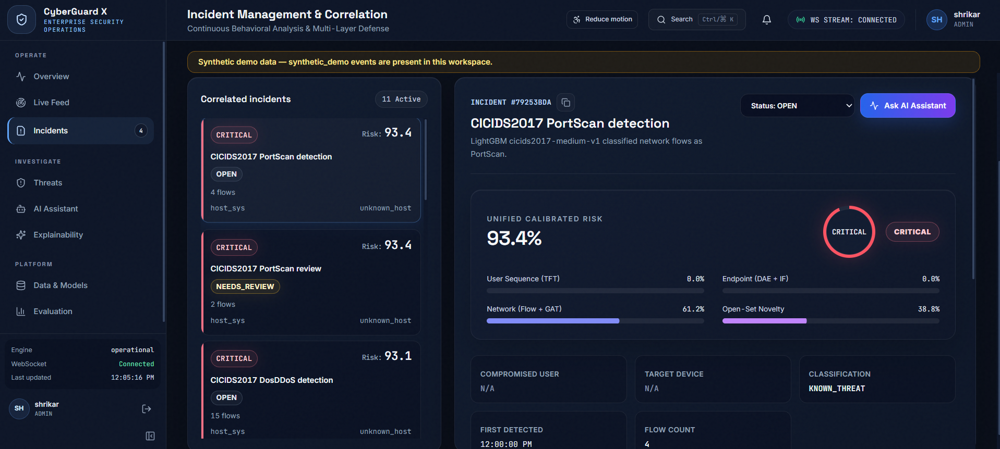
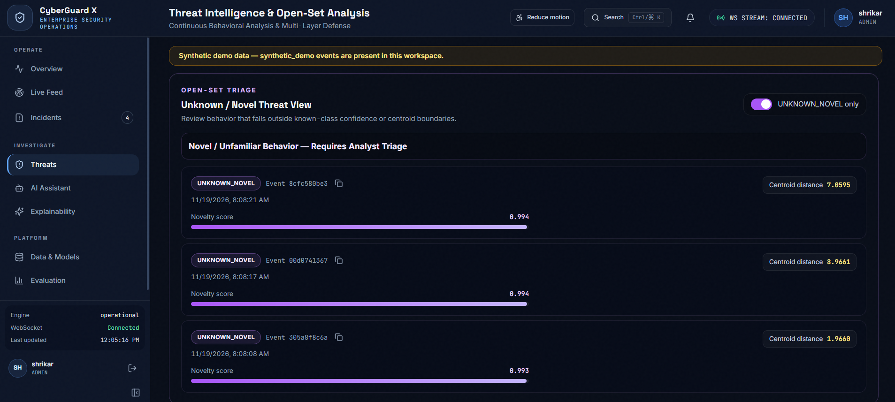
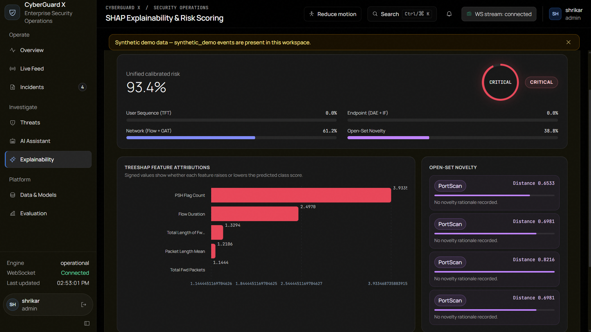
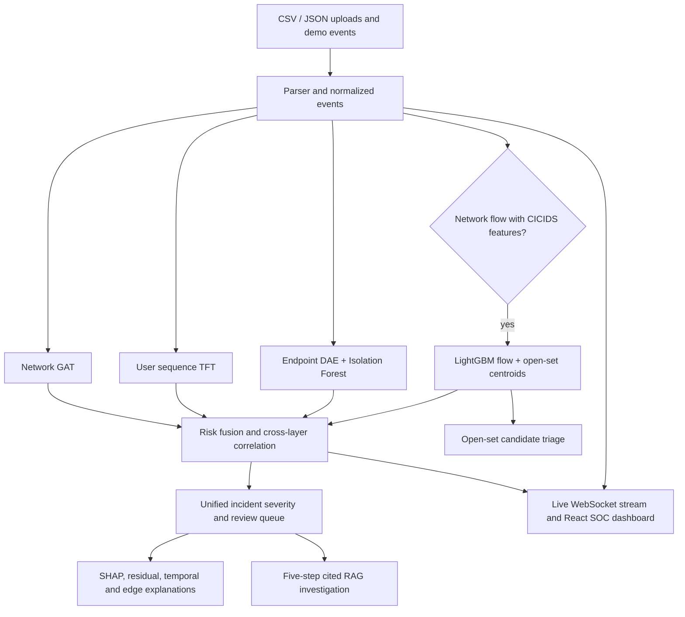

# Enterprise CyberGuard X

Enterprise CyberGuard X is a SOC investigation prototype that combines network-flow classification and open-set recognition with endpoint, user-sequence, and host-graph detectors. Its SOC dashboard shows unified incident risk, branch evidence, unknown/novel triage, multi-modal explainability, and read-only RAG investigations.

## Screenshots

> Taken from a local development workspace with synthetic demo events and a held-out CICIDS2017 replay loaded. They illustrate the interface and are **not** evidence of detection performance; see [docs/RESULTS.md](docs/RESULTS.md) for evaluated results.

### Analyst sign-in

Signed bearer-token login with `viewer`, `analyst` and `admin` roles. There is no default account; the first admin is created from the command line.


### Live telemetry stream

Events arrive over a WebSocket. The amber banner appears whenever `synthetic_demo` events are present: those are developer-written demo scenarios, not real attacks.



### Incident management and correlation

Grouped incidents with a unified risk score and per-branch contribution bars. This example is a CICIDS2017 PortScan incident from the held-out replay. Branches that receive no input for a flow replay (user sequence, endpoint) show 0%. The unified score is a calibrated triage score from a meta-model trained on weakly labeled synthetic rows, not a real-world incident probability.



### Unknown / novel triage

Events outside known-class confidence or centroid boundaries, with centroid distance and novelty score. `UNKNOWN_NOVEL` means "needs analyst review", not a confirmed new attack.



### Grounded AI assistant

Read-only assistant with FAISS retrieval and cited evidence. It recommends steps for human approval and cannot execute actions.


### Explainability and risk scoring

Signed TreeSHAP feature attributions for the LightGBM flow classifier, the unified risk breakdown, and open-set novelty distances.



## Active model and decision pipeline

The codebase contains four trained model families:

1. **Network flow classifier:** LightGBM is the saved live CICIDS model; the evaluation/training code also supports XGBoost.
2. **Endpoint anomaly detector:** PyTorch denoising autoencoder (DAE) plus Isolation Forest.
3. **User sequence model:** Temporal Fusion Transformer (TFT).
4. **Host communication model:** edge-aware Graph Attention Network (GAT).

Their outputs feed two distinct decision layers: open-set centroid/energy/margin checks and logistic-regression stacking risk fusion. The flow classifier's persisted verdict vocabulary includes `KNOWN_THREAT`, `UNKNOWN_CANDIDATE`, and `UNKNOWN_NOVEL`; the detailed open-set `decision_outcome` can report `ABSTAIN_NEEDS_REVIEW`. `KNOWN_ATTACK` is not the current API verdict. The fusion score is a calibrated triage score, not a real-world incident probability.

Model-family presence does not imply independently validated production performance. See [the results and label provenance](docs/RESULTS.md) for saved artifact metadata, benchmark split details, proxy-label caveats, and unavailable external evaluation data.

## Implemented features

- CSV and JSON event ingestion with strict row validation, duplicate detection, optional CICIDS flow scoring, and background processing for large uploads.
- LightGBM CICIDS2017 flow classification with confidence, energy/margin, compact-centroid distance, and calibrated open-set rejection. The stored detector field is `score`; `attack_probability` is derived as `1 - P(BENIGN)`.
- Endpoint behavior scoring with a PyTorch denoising autoencoder and Isolation Forest. The checked-in artifact is unsupervised on 293 Sysmon capture windows; the bundled corpus does not provide a labeled benign/Atomic Red Team test pair.
- A temporal user-sequence model (TFT) for weakly labeled sequence signals and a graph-attention model (GAT) for host-to-host anomaly proxy scores.
- A calibrated logistic risk-fusion model combining user, endpoint, network flow, graph, open-set, and correlation-stage signals into a severity tier and normalized contribution bars.
- SOC views for `UNKNOWN_NOVEL` triage (including centroid distance), per-incident risk contributions, multi-modal explainability, and OSCR/recall/F1/AUPRC evaluation summaries.
- Grouped known-threat and unknown-candidate incidents, bounded sample-event evidence, risk component breakdowns, and probability-gated MITRE mappings.
- Rule-based user and endpoint indicators, cross-layer correlation, and labelled synthetic demo scenarios. These indicators are rules, not ML predictions.
- Four built-in interactive scenarios are implemented in `backend/app/ingestion/scenarios.py`: `multi_stage_takeover`, `brute_force_only`, `benign_admin`, and `normal_employee_day`. The broader target is 12 enterprise attack scenario classes; this repository does not yet define or implement the remaining taxonomy items.
- On-demand signed TreeSHAP explanations for supported CICIDS detections.
- Read-only five-step RAG investigations (`retrieve → analyze → map → summarize → recommend`) with cited evidence, evidence-gated ATT&CK mapping, and human-approval-only recommendations.
- Curated ATT&CK technique references are versioned in `backend/app/rag/knowledge_metadata.json` against Enterprise ATT&CK v20.1. They are not a complete synchronized catalog; ingesting MITRE Detection Strategies/Analytics is planned, not implemented.
- Live event updates over WebSockets, incident review queue, evaluation summary page, and prepared held-out replay through the live engine.
- Background model retraining for the `light` and `medium` profiles. A completed artifact replaces its profile bundle atomically; a failed job leaves the prior bundle in place.

## Architecture



## Run locally

Requirements: Python 3.10+ and Node.js 18+.

Backend, from the repository root:

```powershell
python -m pip install -r backend/requirements.txt
cd backend
uvicorn app.main:app --host 127.0.0.1 --port 8000 --reload
```

The API health URL is [http://127.0.0.1:8000/api/health](http://127.0.0.1:8000/api/health). API docs are at `/docs`; live events use `ws://127.0.0.1:8000/ws/live-events`.

SQLite is the default for local development and CI (`DATABASE_URL=sqlite:///./cyberguardx.db`). PostgreSQL is supported through SQLAlchemy with `postgresql+psycopg2://...`; the Compose deployment starts PostgreSQL with a healthcheck and waits for it before starting the backend. Run `alembic upgrade head` from `backend/` to apply schema migrations.

## Analyst accounts and permissions

The API issues signed bearer tokens from `POST /api/auth/login`. Create the initial admin interactively from `backend/` with `python -m app.cli create_admin`, or set both `ADMIN_USERNAME` and `ADMIN_PASSWORD` for one-time startup setup. Environment bootstrap is ignored once any analyst account exists. Admins create additional accounts with `POST /api/auth/users`. Viewers have read-only access. Analysts can update incident status, add notes, use RAG chat, and analyze or upload telemetry. Admins can additionally load and replay demos, run correlation, retrain models, run evaluations, and manage accounts. Login attempts, incident status changes, and analyst notes are recorded in `analyst_activity`.

Database schema changes are managed by Alembic at startup. New installations are created from the baseline migration. Existing databases are adopted only when their tables and columns match the pre-auth baseline; a mismatch stops startup without dropping data. Back up the database before reviewing a migration. To inspect or run migrations manually from `backend/`, use `alembic current` and `alembic upgrade head`.

Frontend, in another terminal:

```powershell
cd frontend
npm install
npm run dev
```

Open [http://localhost:5173](http://localhost:5173). The Vite development proxy forwards `/api` and `/ws` to the backend.

To prepare the replay file, run this offline from the repository root:

```powershell
python backend/ml/training/make_replay_sample.py
```

It writes a stratified 3,000-row sample to `backend/datasets/replay/replay_sample.csv.gz`. The UI or `python backend/ml/training/replay_test_split.py --n 3000 --speed 10` can request replay from a running backend. Retraining is available at `POST /api/models/retrain` with `{"profile":"light"}` or `{"profile":"medium"}`; poll `/api/models/retrain/status/{job_id}`.

## Docker deployment

Copy `.env.example` to `.env`, then set non-empty `SECRET_KEY` and `POSTGRES_PASSWORD` values. The example shows a URL-safe hex generator for both. Compose stops with a clear error if either value is missing.

```powershell
docker compose up --build
```

The frontend container serves the UI and proxies `/api` and `/ws` to the backend. Its backend health check uses `/api/health`. Open [http://localhost:3000](http://localhost:3000).

Compose uses the PostgreSQL service and persistent `pgdata` volume. Set `DATABASE_URL` to a SQLite URL instead when running the backend directly for local development or CI.

## Results

The generated report is available at [docs/RESULTS.md](docs/RESULTS.md).

The evaluation JSONs contain different split protocols and label sources. Read [docs/RESULTS.md](docs/RESULTS.md) for saved-artifact status, label provenance, and the stratified-versus-session-disjoint comparison. The generated section below remains the older three-seed stratified baseline. Regenerate it after adding evaluation runs with:

```powershell
python scripts/make_results_md.py
```

### Latest CICIDS open-set run

The table below uses the saved **medium profile, seed 42, 50% sample** report [`open_set_compact_margin97_medium_seed42.json`](backend/ml/evaluation/results/open_set_compact_margin97_medium_seed42.json) and the `confidence_energy_compact_union` detector. Values are on held-out unknown attack families; known macro F1 reflects known-class classification on each fold. This is one run, not a multi-seed estimate.

| Held-out attack family | OSCR AUC | Unknown recall | Known macro F1 | AUPRC |
|---|---:|---:|---:|---:|
| DoS/DDoS | 0.9528 | 0.7252 | 0.9428 | 0.8129 |
| PortScan | 0.8315 | 0.0255 | 0.9473 | 0.1026 |
| BruteForce | 0.9696 | 0.2836 | 0.9497 | 0.1060 |
| WebAttack | 0.9905 | 0.9352 | 0.9593 | 0.6307 |
| Bot | 0.7204 | 0.0000 | 0.9891 | 0.0029 |
| Macro mean across these five families | **0.8930** | **0.3939** | **0.9576** | **0.3310** |

These results show strong separation for WebAttack and DoS/DDoS, but weak unknown recall for PortScan and Bot. The unweighted macro average keeps every held-out family equally represented.

### Current branch artifact estimates

These figures are read from the locally saved bundles in `backend/saved_models/`. Metrics are reported only where the artifact contains a validation evaluation; training rows and label notes are included to make the other estimates interpretable.

| Branch / algorithm | Data and split recorded in artifact | Current estimate |
|---|---|---|
| Network flow — LightGBM + open-set fusion | CICIDS2017 medium profile; 50% sample; seed 42; leave-one-family-out evaluation | See the family-level OSCR/recall/F1/AUPRC table above. The bundle includes 78 flow features, compact class centroids, pooled covariance, benign Isolation Forest, energy/margin, and calibrated thresholds. |
| Endpoint — Denoising Autoencoder + Isolation Forest | Saved bundle trained unsupervised on 293 Sysmon capture windows | No independent validation metrics are stored. The checked-in corpus does not establish a labeled benign baseline; do not interpret this bundle as a validated benign-only detector. |
| User sequence — Temporal Fusion Transformer | 1,978 training sequences; 495 validation sequences; 24 steps; Sysmon/CERT weak labels; seed 42 | Validation ROC AUC **0.99998**, accuracy **0.9960**, precision **0.9926**, recall **0.9926** on heuristic proxy labels. This saved bundle predates the new user-disjoint split and records `stratified_sequence_level_80_20`; newly trained bundles use user-group-disjoint validation. |
| Network graph — Graph Attention Network | 12,000 UNSW-NB15 rows; 1,148 rows marked positive; seed 42 | No independent validation metrics are stored. The positive target is “non-benign attack category” as a multi-host anomaly proxy, not ground-truth lateral movement. |
| Risk fusion — calibrated logistic meta-model | 4,800 weakly labeled training rows; 1,200 validation rows; synthetic weak-label source | Validation ROC AUC **0.8573**, Brier score **0.1507**; validation positive rate 52.4%. This is a calibration/meta-model estimate on weak labels, not an end-to-end incident benchmark. |

The current medium-profile split comparison is available in [Markdown](backend/ml/evaluation/results/medium_stratified_vs_session_disjoint.md) and [JSON](backend/ml/evaluation/results/medium_stratified_vs_session_disjoint.json). It uses CICIDS2017 dataset labels, two seeds, and only three supported session-disjoint family/seed folds; see the report's skipped-fold list and uncertainty intervals.

The UI evaluation page reads saved multi-seed evaluation summaries from `/api/evaluation/summary`; a multi-seed result is preferred for model comparisons. The estimates above are the currently available local artifact reports and are not a substitute for repeated, independently labeled test runs.

<!-- GENERATED RESULTS: START -->
## Manifest-tracked multi-seed baseline

This generated table is the three-seed baseline for the earlier confidence/Isolation-Forest/Mahalanobis detector set. For the newer compact-centroid/energy detector's seed-42 metrics, see the latest run above.

Generated from completed JSON files in `backend/ml/evaluation/results/`. Means and population standard deviations are computed across saved seeds. Low support means fewer than 200 unknown test rows in at least one seed.

### medium (3 seeds)

| Family | Detector | AUROC mean ± sd | Unknown rejection mean ± sd | Seeds | Support |
|---|---|---:|---:|---:|---|
| Bot | confidence | 0.6755 ± 0.0546 | 0.1743 ± 0.0885 | 3 | ⚠ LOW SUPPORT (<200) |
| Bot | confidence_mahalanobis_rank_average | 0.6705 ± 0.0404 | 0.2335 ± 0.0124 | 3 | ⚠ LOW SUPPORT (<200) |
| Bot | isolation_forest | 0.6167 ± 0.0139 | 0.0203 ± 0.0110 | 3 | ⚠ LOW SUPPORT (<200) |
| Bot | mahalanobis | 0.6452 ± 0.0105 | 0.0372 ± 0.0024 | 3 | ⚠ LOW SUPPORT (<200) |
| Bot | union_conf_mahalanobis | 0.6173 ± 0.0662 | 0.1201 ± 0.1233 | 3 | ⚠ LOW SUPPORT (<200) |
| BruteForce | confidence | 0.9448 ± 0.0447 | 0.7494 ± 0.3529 | 3 | OK |
| BruteForce | confidence_mahalanobis_rank_average | 0.9509 ± 0.0173 | 0.5599 ± 0.2504 | 3 | OK |
| BruteForce | isolation_forest | 0.7851 ± 0.0075 | 0.0000 ± 0.0000 | 3 | OK |
| BruteForce | mahalanobis | 0.8302 ± 0.0012 | 0.0019 ± 0.0005 | 3 | OK |
| BruteForce | union_conf_mahalanobis | 0.9047 ± 0.0708 | 0.2610 ± 0.0168 | 3 | OK |
| DosDDoS | confidence | 0.9558 ± 0.0090 | 0.8104 ± 0.0084 | 3 | OK |
| DosDDoS | confidence_mahalanobis_rank_average | 0.9841 ± 0.0044 | 0.9588 ± 0.0082 | 3 | OK |
| DosDDoS | isolation_forest | 0.9590 ± 0.0025 | 0.8122 ± 0.0064 | 3 | OK |
| DosDDoS | mahalanobis | 0.9597 ± 0.0008 | 0.7972 ± 0.0064 | 3 | OK |
| DosDDoS | union_conf_mahalanobis | 0.9720 ± 0.0033 | 0.8307 ± 0.0118 | 3 | OK |
| PortScan | confidence | 0.8187 ± 0.0625 | 0.1170 ± 0.0655 | 3 | OK |
| PortScan | confidence_mahalanobis_rank_average | 0.8673 ± 0.0304 | 0.0561 ± 0.0197 | 3 | OK |
| PortScan | isolation_forest | 0.8083 ± 0.0154 | 0.0032 ± 0.0006 | 3 | OK |
| PortScan | mahalanobis | 0.7864 ± 0.0009 | 0.0079 ± 0.0011 | 3 | OK |
| PortScan | union_conf_mahalanobis | 0.7687 ± 0.0403 | 0.0347 ± 0.0205 | 3 | OK |
| WebAttack | confidence | 0.9894 ± 0.0048 | 0.9599 ± 0.0109 | 3 | OK |
| WebAttack | confidence_mahalanobis_rank_average | 0.9351 ± 0.0030 | 0.0309 ± 0.0221 | 3 | OK |
| WebAttack | isolation_forest | 0.6416 ± 0.0261 | 0.0123 ± 0.0175 | 3 | OK |
| WebAttack | mahalanobis | 0.7384 ± 0.0113 | 0.0324 ± 0.0038 | 3 | OK |
| WebAttack | union_conf_mahalanobis | 0.9949 ± 0.0005 | 0.9753 ± 0.0079 | 3 | OK |

<!-- GENERATED RESULTS: END -->

## Known limitations

- Older saved CICIDS open-set runs use stratified row splits and can leak capture-session near-duplicates. A separate GroupShuffleSplit comparison is now saved; its session-disjoint half had only three supported folds out of ten because some selected test sessions lacked the held-out family.
- Evaluation profiles use 15% (`light`) and 50% (`medium`) data samples; results do not represent a full-data run.
- TFT, GAT, and fusion estimates are weakly supervised or synthetic proxies. The current endpoint bundle has no labeled benign-versus-Atomic-Red-Team evaluation; separate capture directories are required to generate those metrics. The checked-in Sysmon collection alone is not a labeled benign baseline.
- Cross-layer correlation thresholds are demo values and are not calibrated.
- PortScan detection is weaker than desired and should be reviewed alongside the per-family results below.
- RAG retrieval has a fixed 20-question check (saved result: hit@1 0.85 and hit@3 0.90); this is limited coverage, not a broad operational validation.

## Tests

Run the backend suite with:

```powershell
python -m pytest backend/tests -v
```
