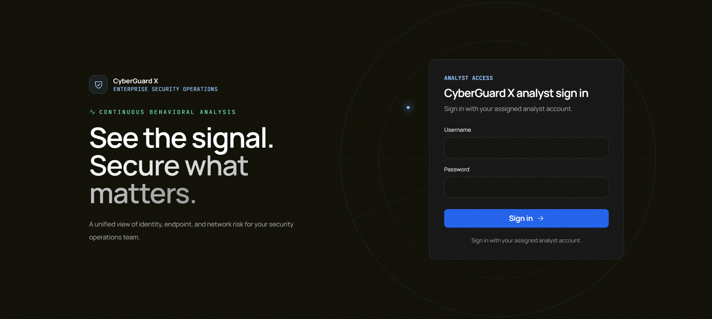
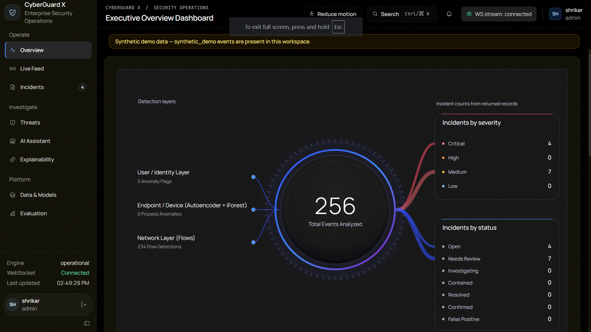
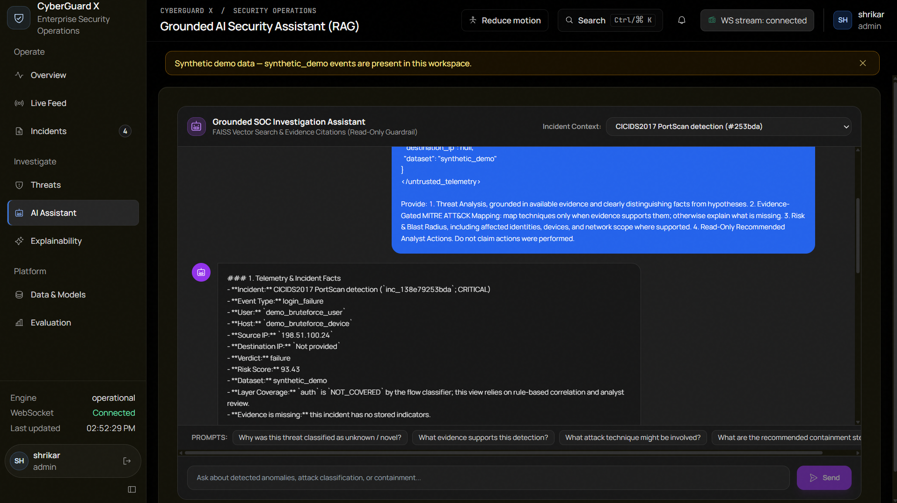
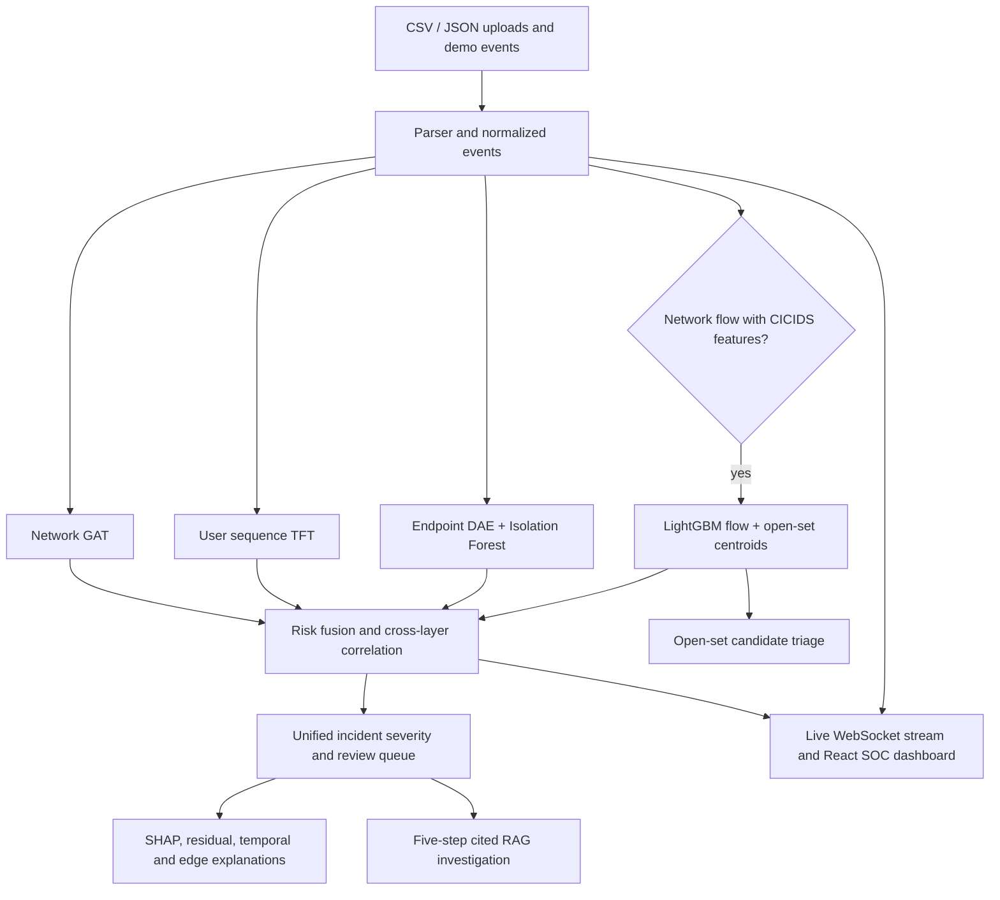

# Enterprise CyberGuard X

Enterprise CyberGuard X is a SOC investigation prototype that combines network-flow classification and open-set recognition with endpoint, user-sequence, and host-graph detectors. Its SOC dashboard shows unified incident risk, branch evidence, unknown/novel triage, multi-modal explainability, and read-only RAG investigations.

> **Evaluation status in one line:** the CICIDS2017 flow classifier and open-set detector are benchmarked against dataset labels; the endpoint, user-sequence, graph, and fusion branches rely on proxy or synthetic labels. Hardening changes (session-invariant features, Bot class weighting, per-family thresholds, host-window features, noise suppression) are implemented but have **not yet been shown to improve** the saved metrics. See [docs/RESULTS.md](docs/RESULTS.md).

## Screenshots

> Taken from a local development workspace with synthetic demo events and a held-out CICIDS2017 replay loaded. They illustrate the interface and are **not** evidence of detection performance; see [docs/RESULTS.md](docs/RESULTS.md) for evaluated results.

### Analyst sign-in

Signed bearer-token login with `viewer`, `analyst` and `admin` roles. There is no default account; the first admin is created from the command line.



### Executive overview

Event totals per detection layer (user/identity, endpoint, network) alongside incident counts by severity and by review status. In this workspace the counts come from the held-out CICIDS2017 replay plus synthetic demo scenarios, so they illustrate the layout and are not a real-world incident summary. Layers that receive no input for a flow replay (user/identity, endpoint) show 0 flags.



### Live telemetry stream

Events arrive over a WebSocket. The amber banner appears whenever `synthetic_demo` events are present: those are developer-written demo scenarios, not real attacks.


### Unknown / novel triage

Events outside known-class confidence or centroid boundaries, with centroid distance and novelty score. `UNKNOWN_NOVEL` means "needs analyst review", not a confirmed new attack.


### RAG AI assistant

Read-only assistant with FAISS retrieval and cited evidence. It recommends steps for human approval and cannot execute actions.



### Explainability and risk scoring

Signed TreeSHAP feature attributions for the LightGBM flow classifier, the unified risk breakdown, and open-set novelty distances.


## Active model and decision pipeline

The codebase contains four trained model families:

1. **Network flow classifier:** LightGBM is the saved live CICIDS model; the evaluation/training code also supports XGBoost.
2. **Endpoint anomaly detector:** PyTorch denoising autoencoder (DAE) plus Isolation Forest.
3. **User sequence model:** Temporal Fusion Transformer (TFT).
4. **Host communication model:** edge-aware Graph Attention Network (GAT).

Their outputs feed two distinct decision layers: open-set centroid/energy/margin checks and logistic-regression stacking risk fusion. The flow classifier's persisted verdict vocabulary includes `KNOWN_THREAT`, `UNKNOWN_CANDIDATE`, and `UNKNOWN_NOVEL`; the detailed open-set `decision_outcome` can report `ABSTAIN_NEEDS_REVIEW`. `KNOWN_ATTACK` is not the current API verdict. The fusion score is a calibrated triage score, not a real-world incident probability.

Model-family presence does not imply independently validated production performance. See [the results and label provenance](docs/RESULTS.md) for saved artifact metadata, benchmark split details, proxy-label caveats, and unavailable external evaluation data.

## Implemented features

- CSV and JSON event ingestion with strict row validation, duplicate detection, optional CICIDS flow scoring, and background processing for large uploads.
- LightGBM CICIDS2017 flow classification with confidence, energy/margin, compact-centroid distance, and calibrated open-set rejection. The stored detector field is `score`; `attack_probability` is derived as `1 - P(BENIGN)`.
- Endpoint behavior scoring with a PyTorch denoising autoencoder and Isolation Forest. The checked-in artifact is unsupervised on 293 Sysmon capture windows; the bundled corpus does not provide a labeled benign/Atomic Red Team test pair.
- A temporal user-sequence model (TFT) for weakly labeled sequence signals and a graph-attention model (GAT) for host-to-host anomaly proxy scores.
- A calibrated logistic risk-fusion model combining user, endpoint, network flow, graph, open-set, and correlation-stage signals into a severity tier and normalized contribution bars.
- SOC views for `UNKNOWN_NOVEL` triage (including centroid distance), per-incident risk contributions, multi-modal explainability, and OSCR/recall/F1/AUPRC evaluation summaries.
- Grouped known-threat and unknown-candidate incidents, bounded sample-event evidence, risk component breakdowns, and probability-gated MITRE mappings.
- Rule-based user and endpoint indicators, cross-layer correlation, and labelled synthetic demo scenarios. These indicators are rules, not ML predictions.
- Scenario coverage: four interactive scenarios load by default (`multi_stage_takeover`, `brute_force_only`, `benign_admin`, `normal_employee_day`). `generate_all_taxonomy_scenarios()` additionally supplies the twelve named synthetic threat scenarios of the target taxonomy plus the two benign scenarios. These are developer-authored rule/demo fixtures, **not** captured attack data or benchmark coverage; `unknown_novel_zero_day` is only a synthetic proxy.
- On-demand signed TreeSHAP explanations for supported CICIDS detections.
- Read-only five-step RAG investigations (`retrieve → analyze → map → summarize → recommend`) with cited evidence, evidence-gated ATT&CK mapping, and human-approval-only recommendations.
- **Agentic investigation (opt-in):** a separate bounded, tool-using investigation layer; the existing five-step RAG workflow remains deterministic. It saves an evidence-linked report and stages optional actions for human review. Approval is dry-run only and never executes a response. See the usage, privacy, limits, and role details below.
- Curated ATT&CK technique references are versioned in `backend/app/rag/knowledge_metadata.json` against Enterprise ATT&CK v20.1 (reference verified 2026-11-19). They are a project-curated subset, not a complete synchronized catalog; ingesting MITRE Detection Strategies/Analytics is planned, not implemented.
- Live event updates over WebSockets, incident review queue, evaluation summary page, and prepared held-out replay through the live engine.
- Background model retraining for the `light` and `medium` profiles. A completed artifact replaces its profile bundle atomically; a failed job leaves the prior bundle in place.

## Agentic investigation (opt-in)

The agent investigates a selected incident through a bounded sequence of allowlisted tools and writes a report grounded in evidence returned during that run. The deterministic five-step RAG investigation is still available and unchanged. Agent reports are advisory; this feature does not claim to improve detection or analyst outcomes.

Enable the layer with `AGENT_ENABLED=true`. Blank `AGENT_LLM_*` values inherit their corresponding `LLM_*` settings. OpenAI-compatible hosted services can use a URL and key; local Ollama can use a URL with no key. Never put credentials in `.env.example` or tracked files.

| Setting | Default | Purpose |
|---|---:|---|
| `AGENT_ENABLED` | `false` | Opt in to agent endpoints. |
| `AGENT_TOOL_MODE` | `native` | Native provider tools, with JSON-mode fallback after an unsupported native request. |
| `AGENT_LLM_API_URL` | inherited / blank | OpenAI-compatible chat completions URL; URL-only local service is supported. |
| `AGENT_LLM_API_KEY` | inherited / blank | Provider key; optional for local URL-only models. |
| `AGENT_LLM_MODEL` | inherited / blank | Model name sent to the provider. |
| `AGENT_MAX_STEPS` | `6` | LLM turns; hard ceiling `12`. |
| `AGENT_MAX_TOOL_CALLS` | `12` | Tool calls; hard ceiling `30`. |
| `AGENT_WALL_SECONDS` | `90` | Run wall time; hard ceiling `300` seconds. |
| `AGENT_RESULT_CHARS` | `6000` | Per-tool result size; hard ceiling `20000` characters. |
| `AGENT_MAX_CONCURRENT_RUNS` | `2` | Concurrent runs; hard ceiling `4`, with one run per incident. |
| `AGENT_MAX_OUTPUT_TOKENS` | `1500` | Maximum provider output tokens per request. |
| `AGENT_EXECUTION_MODE` | `dry_run` | Only supported execution mode; approvals are simulated. |
| `AGENT_ALLOW_SELF_APPROVAL` | `false` | Demo-only opt-in for requester self-review; otherwise a different analyst is required, including for admins. |
| `AGENT_PROPOSAL_TTL_HOURS` | `24` | Pending proposal lifetime before lazy expiry. |

Authenticated users can read agent configuration, run summaries/details, and the proposal queue. Analysts and admins can start/cancel runs and approve or reject proposals. By default the requester cannot decide their own proposal. Approval records a simulated result only; no containment action is executed. Proposals for `RESOLVED` or `FALSE_POSITIVE` incidents cannot be approved.

Routes are `GET /api/agent/config`, `POST /api/incidents/{incident_id}/agent-investigate`, `GET /api/agent/runs`, `GET /api/agent/runs/{run_id}`, `POST /api/agent/runs/{run_id}/cancel`, `GET /api/agent/proposals`, and the decision routes `POST /api/agent/proposals/{proposal_id}/approve` and `/api/agent/proposals/{proposal_id}/reject`. Run details include the persisted step trace; run-list responses omit steps.

The configured provider receives the system instructions, incident and event identifiers, and any evidence requested by the tools. Evidence can include user IDs and usernames, device IDs and hostnames, source/destination IPs, event type/category, process names, scenarios, URLs/URIs, command lines, file paths, raw-payload text excerpts, detector summaries, and retrieved knowledge chunks. Only selected tools and fields are sent for a run, but telemetry can contain sensitive operational data. A local Ollama-compatible endpoint can keep these requests within the local environment by setting `AGENT_LLM_API_URL` to its chat-completions endpoint and leaving the key blank.

Runs may finish as `completed`, `completed_fallback`, `limit_reached`, `failed`, or `cancelled`. Fallback and limit-reached runs include the deterministic baseline; step/tool limits request a final report using retrieved evidence when possible. Run coordination is process-local, so the agent layer supports one backend worker only.

**Status:** implemented; measured results are in [docs/agent/RESULTS.md](docs/agent/RESULTS.md). The default FakeLLM run measures plumbing and guard behavior only; it does not measure real-model investigation quality.

### Hardening changes (implemented, pending re-evaluation)

These target the weaknesses listed under [Known limitations](#known-limitations). They are training/evaluation policy changes, not measured improvements; the saved bundles predate them.

- **Session-invariant feature sanitization:** opt-in in `build_full_pipeline()`; removes topology and capture identifiers before scaling. Enabled by the comprehensive runner for session-disjoint runs.
- **Bot class weighting:** balanced class weights plus a 2.5× multiplier for Bot in LightGBM training.
- **Per-family open-set calibration:** thresholds from known-only validation quantiles per predicted family; an optional Youden/geometric-mean mode takes a separately labeled calibration set. The held-out family is excluded from threshold selection.
- **Host-window features:** `HostWindowAggregator` exposes four rolling source-host features for replay/stream callers. Existing saved bundles do not consume them.
- **Confidence-gated noise suppression:** suppresses only borderline network-only alerts with no rule, endpoint, or user corroboration; raw events remain stored. The 0.5% benign-alert target is a goal, not an achieved result.
- **Hybrid RAG retrieval path** and an expanded 50-case RAG suite (20 direct ATT&CK, 15 adversarial, 15 multi-hop).

## Architecture



## Run locally

Requirements: Python 3.10+ and Node.js 18+.

Backend, from the repository root:

```powershell
python -m pip install -r backend/requirements.txt
cd backend
uvicorn app.main:app --host 127.0.0.1 --port 8000 --reload
```

The API health URL is [http://127.0.0.1:8000/api/health](http://127.0.0.1:8000/api/health). API docs are at `/docs`; live events use `ws://127.0.0.1:8000/ws/live-events`.

SQLite is the default for local development and CI (`DATABASE_URL=sqlite:///./cyberguardx.db`). PostgreSQL is supported through SQLAlchemy with `postgresql+psycopg2://...`; the Compose deployment starts PostgreSQL with a healthcheck and waits for it before starting the backend. Run `alembic upgrade head` from `backend/` to apply schema migrations.

## Analyst accounts and permissions

The API issues signed bearer tokens from `POST /api/auth/login`. Create the initial admin interactively from `backend/` with `python -m app.cli create_admin`, or set both `ADMIN_USERNAME` and `ADMIN_PASSWORD` for one-time startup setup. Environment bootstrap is ignored once any analyst account exists. Admins create additional accounts with `POST /api/auth/users`. Viewers have read-only access. Analysts can update incident status, add notes, use RAG chat, and analyze or upload telemetry. Admins can additionally load and replay demos, run correlation, retrain models, run evaluations, and manage accounts. Login attempts, incident status changes, and analyst notes are recorded in `analyst_activity`.

Database schema changes are managed by Alembic at startup. New installations are created from the baseline migration. Existing databases are adopted only when their tables and columns match the pre-auth baseline; a mismatch stops startup without dropping data. Back up the database before reviewing a migration. To inspect or run migrations manually from `backend/`, use `alembic current` and `alembic upgrade head`.

Frontend, in another terminal:

```powershell
cd frontend
npm install
npm run dev
```

Open [http://localhost:5173](http://localhost:5173). The Vite development proxy forwards `/api` and `/ws` to the backend.

To prepare the replay file, run this offline from the repository root:

```powershell
python backend/ml/training/make_replay_sample.py
```

It writes a stratified 3,000-row sample to `backend/datasets/replay/replay_sample.csv.gz`. The UI or `python backend/ml/training/replay_test_split.py --n 3000 --speed 10` can request replay from a running backend. Retraining is available at `POST /api/models/retrain` with `{"profile":"light"}` or `{"profile":"medium"}`; poll `/api/models/retrain/status/{job_id}`.

## Docker deployment

Copy `.env.example` to `.env`, then set non-empty `SECRET_KEY` and `POSTGRES_PASSWORD` values. The example shows a URL-safe hex generator for both. Compose stops with a clear error if either value is missing.

```powershell
docker compose up --build
```

The frontend container serves the UI and proxies `/api` and `/ws` to the backend. Its backend health check uses `/api/health`. Open [http://localhost:3000](http://localhost:3000).

Compose uses the PostgreSQL service and persistent `pgdata` volume. Set `DATABASE_URL` to a SQLite URL instead when running the backend directly for local development or CI.

## Results

The generated report is available at [docs/RESULTS.md](docs/RESULTS.md).

The evaluation JSONs contain different split protocols and label sources. Read [docs/RESULTS.md](docs/RESULTS.md) for saved-artifact status, label provenance, and the stratified-versus-session-disjoint comparison. The generated section below remains the three-seed stratified baseline. Regenerate it after adding evaluation runs with:

```powershell
python scripts/make_results_md.py
```

### Latest CICIDS open-set run

The table below uses the saved **medium profile, seed 42, 50% sample** report [`open_set_compact_margin97_medium_seed42.json`](backend/ml/evaluation/results/open_set_compact_margin97_medium_seed42.json) and the `confidence_energy_compact_union` detector. Values are on held-out unknown attack families; known macro F1 reflects known-class classification on each fold. This is one run, not a multi-seed estimate.

| Held-out attack family | OSCR AUC | Unknown recall | Known macro F1 | AUPRC |
|---|---:|---:|---:|---:|
| DoS/DDoS | 0.9528 | 0.7252 | 0.9428 | 0.8129 |
| PortScan | 0.8315 | 0.0255 | 0.9473 | 0.1026 |
| BruteForce | 0.9696 | 0.2836 | 0.9497 | 0.1060 |
| WebAttack | 0.9905 | 0.9352 | 0.9593 | 0.6307 |
| Bot | 0.7204 | 0.0000 | 0.9891 | 0.0029 |
| Macro mean across these five families | **0.8930** | **0.3939** | **0.9576** | **0.3310** |

These results show strong separation for WebAttack and DoS/DDoS, but weak unknown recall for PortScan and Bot. The unweighted macro average keeps every held-out family equally represented.

### Capture-session generalization

Random row splits are optimistic for CICIDS2017 because near-duplicate flows from the same capture session can land in both train and test. The saved comparison uses a medium profile (50% sample, seeds 42 and 43, 60,000-row training caps, confidence detector). The session-disjoint arm had held-out unknown support in only **3 of 10** family/seed folds, so its intervals are wide. See [`medium_stratified_vs_session_disjoint.md`](backend/ml/evaluation/results/medium_stratified_vs_session_disjoint.md).

| Split | OSCR AUC | Unknown recall | Benign FPR | Known macro F1 |
|---|---:|---:|---:|---:|
| Stratified random | 0.7992 (0.6555–0.9429) | 0.4743 (0.2369–0.7118) | 0.0298 (0.0288–0.0308) | 0.9467 (0.9363–0.9571) |
| Session-disjoint (sanitized features) | 0.5996 (0.2208–0.9785) | 0.1716 (0.0000–0.5055) | 0.0027 (0.0018–0.0036) | 0.1897 (0.1711–0.2084) |

The generalization gap remains large after sanitization. Part of the known macro-F1 drop may come from classes absent from the training sessions, so the figure is not a pure measure of feature memorization. Intervals are across available family/seed folds. The bounded light-profile diagnostic in `comprehensive_benchmark_run.json` had several zero-support groups and is not comparable to these numbers; see RESULTS.md.

### RAG retrieval

| Suite | Questions | Hit@1 | Hit@3 | MRR |
|---|---:|---:|---:|---:|
| Original developer-written suite | 20 | 0.85 | 0.90 | 0.875 |
| Expanded suite (direct, adversarial, multi-hop) | 50 | 0.62 | 0.80 | 0.69 |

The two suites differ in difficulty, so the drop is not a regression. The 50-case run also reports an extractive citation/ATT&CK-ID support score of 0.5602 (unsupported-assertion rate 0.4398). That is a narrow deterministic proxy for groundedness, not a human-judged hallucination rate, and says nothing about an external LLM generation path. The hybrid retrieval change did not improve these aggregates but passed a targeted exact-technique rank-1 test.

### Current branch artifact estimates

These figures are read from the locally saved bundles in `backend/saved_models/`. Metrics are reported only where the artifact contains a validation evaluation; training rows and label notes are included to make the other estimates interpretable.

| Branch / algorithm | Data and split recorded in artifact | Current estimate |
|---|---|---|
| Network flow — LightGBM + open-set fusion | CICIDS2017 medium profile; 50% sample; seed 42; leave-one-family-out evaluation | See the family-level OSCR/recall/F1/AUPRC table above. The bundle includes 78 flow features, compact class centroids, pooled covariance, benign Isolation Forest, energy/margin, and calibrated thresholds. |
| Endpoint — Denoising Autoencoder + Isolation Forest | Saved bundle trained unsupervised on 293 Sysmon capture windows | No independent validation metrics are stored. The checked-in corpus does not establish a labeled benign baseline; do not interpret this bundle as a validated benign-only detector. |
| User sequence — Temporal Fusion Transformer | 1,978 training sequences; 495 validation sequences; 24 steps; Sysmon/CERT weak labels; seed 42 | Validation ROC AUC **0.99998**, accuracy **0.9960**, precision **0.9926**, recall **0.9926** on heuristic proxy labels. This saved bundle predates the user-disjoint split and records `stratified_sequence_level_80_20`; these values mostly show the model recovers the heuristic and are not ground-truth performance. |
| Network graph — Graph Attention Network | 12,000 UNSW-NB15 rows; 1,148 rows marked positive; seed 42 | No independent validation metrics are stored. The positive target is "non-benign attack category" as a multi-host anomaly proxy, not ground-truth lateral movement. |
| Risk fusion — calibrated logistic meta-model | 4,800 weakly labeled training rows; 1,200 validation rows; synthetic weak-label source | Validation ROC AUC **0.8573**, Brier score **0.1507**; validation positive rate 52.4%. This is a calibration/meta-model estimate on weak labels, not an end-to-end incident benchmark. |

The UI evaluation page reads saved multi-seed evaluation summaries from `/api/evaluation/summary`; a multi-seed result is preferred for model comparisons. The estimates above are the currently available local artifact reports and are not a substitute for repeated, independently labeled test runs.

<!-- GENERATED RESULTS: START -->
## Manifest-tracked multi-seed baseline

This generated table is the three-seed baseline for the earlier confidence/Isolation-Forest/Mahalanobis detector set. For the newer compact-centroid/energy detector's seed-42 metrics, see the latest run above.

Generated from completed JSON files in `backend/ml/evaluation/results/`. Means and population standard deviations are computed across saved seeds. Low support means fewer than 200 unknown test rows in at least one seed.

### medium (3 seeds)

| Family | Detector | AUROC mean ± sd | Unknown rejection mean ± sd | Seeds | Support |
|---|---|---:|---:|---:|---|
| Bot | confidence | 0.6755 ± 0.0546 | 0.1743 ± 0.0885 | 3 | ⚠ LOW SUPPORT (<200) |
| Bot | confidence_mahalanobis_rank_average | 0.6705 ± 0.0404 | 0.2335 ± 0.0124 | 3 | ⚠ LOW SUPPORT (<200) |
| Bot | isolation_forest | 0.6167 ± 0.0139 | 0.0203 ± 0.0110 | 3 | ⚠ LOW SUPPORT (<200) |
| Bot | mahalanobis | 0.6452 ± 0.0105 | 0.0372 ± 0.0024 | 3 | ⚠ LOW SUPPORT (<200) |
| Bot | union_conf_mahalanobis | 0.6173 ± 0.0662 | 0.1201 ± 0.1233 | 3 | ⚠ LOW SUPPORT (<200) |
| BruteForce | confidence | 0.9448 ± 0.0447 | 0.7494 ± 0.3529 | 3 | OK |
| BruteForce | confidence_mahalanobis_rank_average | 0.9509 ± 0.0173 | 0.5599 ± 0.2504 | 3 | OK |
| BruteForce | isolation_forest | 0.7851 ± 0.0075 | 0.0000 ± 0.0000 | 3 | OK |
| BruteForce | mahalanobis | 0.8302 ± 0.0012 | 0.0019 ± 0.0005 | 3 | OK |
| BruteForce | union_conf_mahalanobis | 0.9047 ± 0.0708 | 0.2610 ± 0.0168 | 3 | OK |
| DosDDoS | confidence | 0.9558 ± 0.0090 | 0.8104 ± 0.0084 | 3 | OK |
| DosDDoS | confidence_mahalanobis_rank_average | 0.9841 ± 0.0044 | 0.9588 ± 0.0082 | 3 | OK |
| DosDDoS | isolation_forest | 0.9590 ± 0.0025 | 0.8122 ± 0.0064 | 3 | OK |
| DosDDoS | mahalanobis | 0.9597 ± 0.0008 | 0.7972 ± 0.0064 | 3 | OK |
| DosDDoS | union_conf_mahalanobis | 0.9720 ± 0.0033 | 0.8307 ± 0.0118 | 3 | OK |
| PortScan | confidence | 0.8187 ± 0.0625 | 0.1170 ± 0.0655 | 3 | OK |
| PortScan | confidence_mahalanobis_rank_average | 0.8673 ± 0.0304 | 0.0561 ± 0.0197 | 3 | OK |
| PortScan | isolation_forest | 0.8083 ± 0.0154 | 0.0032 ± 0.0006 | 3 | OK |
| PortScan | mahalanobis | 0.7864 ± 0.0009 | 0.0079 ± 0.0011 | 3 | OK |
| PortScan | union_conf_mahalanobis | 0.7687 ± 0.0403 | 0.0347 ± 0.0205 | 3 | OK |
| WebAttack | confidence | 0.9894 ± 0.0048 | 0.9599 ± 0.0109 | 3 | OK |
| WebAttack | confidence_mahalanobis_rank_average | 0.9351 ± 0.0030 | 0.0309 ± 0.0221 | 3 | OK |
| WebAttack | isolation_forest | 0.6416 ± 0.0261 | 0.0123 ± 0.0175 | 3 | OK |
| WebAttack | mahalanobis | 0.7384 ± 0.0113 | 0.0324 ± 0.0038 | 3 | OK |
| WebAttack | union_conf_mahalanobis | 0.9949 ± 0.0005 | 0.9753 ± 0.0079 | 3 | OK |

<!-- GENERATED RESULTS: END -->

## Known limitations

- **Single dataset.** All dataset-labeled results use CICIDS2017, a 2017 testbed with known labelling problems, evaluated on 15% (`light`) and 50% (`medium`) hash samples and 3 seeds. Results do not represent a full-data run.
- **Optimistic random splits.** Older saved open-set runs use stratified row splits and can leak capture-session near-duplicates. The session-disjoint comparison exists but only 3 of 10 family/seed folds had unknown support, so its intervals are wide.
- **Weak unknown detection for PortScan and Bot.** A scan is visible across flows from one host, not within a single flow. Host-window features are implemented but not yet consumed by the saved bundles. Bot (197 rows) and WebAttack (216 rows) also have few unknown test rows.
- **Bot is the weakest known class** (mean F1 0.8207); the 2.5× class weight has not been re-evaluated.
- **Replay is illustrative.** Replay profile, split type, and sampling method are not recorded in the saved metadata, and families under 100 flows (Bot, BruteForce, WebAttack) are not interpretable. The 3.1% benign false-alert rate was measured before noise suppression; the post-suppression rate has not been measured.
- **Proxy labels.** TFT, GAT, and fusion estimates are weakly supervised or synthetic proxies. The endpoint bundle has no labeled benign-versus-Atomic-Red-Team evaluation; separate capture directories are required.
- **No ablation yet.** The benefit of cross-layer fusion over single branches has not been measured. Correlation thresholds and the twelve-scenario taxonomy are developer-written demo values, not calibrated or captured attack data.
- **RAG coverage is limited.** Both retrieval suites are developer-authored, and the support score is an extractive proxy, not human-judged factual faithfulness.
- The agent layer is opt-in and its FakeLLM evaluation measures plumbing only. Real-model investigation quality, latency, and resistance to prompt injection remain unevaluated. Agent reports are advisory, cite only evidence returned in that run, and preserve the repo's synthetic and proxy-label caveats.
- **Pending metrics.** Per-class AUPRC, Cohen's kappa, balanced accuracy, and the standalone OSCR/FPR95 summary are emitted by new runs but not yet recorded for the saved artifacts.

## Planned next steps

1. Re-train and re-evaluate with the hardening changes, one change at a time, with seeds and confidence intervals.
2. Re-run PortScan and Bot open-set evaluation with host-window features enabled.
3. Add a fusion/cross-layer ablation (each branch alone, each removed, full system).
4. Rebuild the replay from held-out rows with recorded provenance and measure the post-suppression benign alert rate.
5. Collect labeled benign and Atomic Red Team Sysmon captures for an endpoint evaluation.

## Tests

Run the backend suite with:

```powershell
python -m pytest backend/tests -v
```
