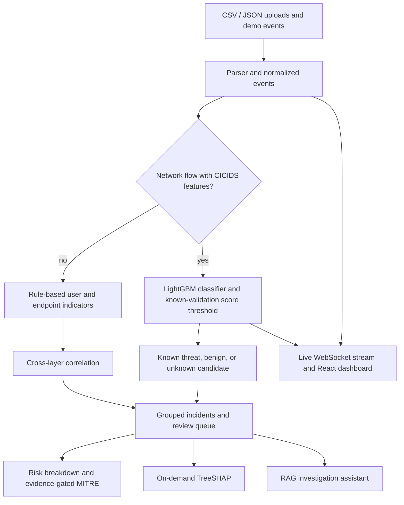

# Enterprise CyberGuard X

Enterprise CyberGuard X is a SOC investigation prototype that combines CICIDS2017 network-flow classification, open-set rejection, rule-based cross-layer correlation, incident review, and retrieval-assisted analyst guidance.

## Implemented features

- CSV and JSON event ingestion with strict row validation, duplicate detection, optional CICIDS flow scoring, and background processing for large uploads.
- LightGBM CICIDS2017 flow classification with a known-validation logit-margin threshold. The stored detector field is `score`; `attack_probability` is derived as `1 - P(BENIGN)`.
- Grouped known-threat and unknown-candidate incidents, bounded sample-event evidence, risk component breakdowns, and probability-gated MITRE mappings.
- Rule-based user and endpoint indicators, cross-layer correlation, and labelled synthetic demo scenarios. These indicators are rules, not ML predictions.
- On-demand signed TreeSHAP explanations for supported CICIDS detections.
- RAG investigation assistance using the local knowledge base, Sentence Transformers embeddings, and a FAISS or NumPy index backend.
- Live event updates over WebSockets, incident review queue, evaluation summary page, and prepared held-out replay through the live engine.
- Background model retraining for the `light` and `medium` profiles. A completed artifact replaces its profile bundle atomically; a failed job leaves the prior bundle in place.

## Architecture



## Run locally

Requirements: Python 3.10+ and Node.js 18+.

Backend, from the repository root:

```powershell
python -m pip install -r backend/requirements.txt
cd backend
uvicorn app.main:app --host 127.0.0.1 --port 8000 --reload
```

The API health URL is [http://127.0.0.1:8000/api/health](http://127.0.0.1:8000/api/health). API docs are at `/docs`; live events use `ws://127.0.0.1:8000/ws/live-events`.

## Analyst accounts and permissions

The API issues signed bearer tokens from `POST /api/auth/login`. Create the initial admin interactively from `backend/` with `python -m app.cli create_admin`, or set both `ADMIN_USERNAME` and `ADMIN_PASSWORD` for one-time startup setup. Environment bootstrap is ignored once any analyst account exists. Admins create additional accounts with `POST /api/auth/users`. Viewers have read-only access. Analysts can update incident status, add notes, use RAG chat, and analyze or upload telemetry. Admins can additionally load and replay demos, run correlation, retrain models, run evaluations, and manage accounts. Login attempts, incident status changes, and analyst notes are recorded in `analyst_activity`.

Database schema changes are managed by Alembic at startup. New installations are created from the baseline migration. Existing databases are adopted only when their tables and columns match the pre-auth baseline; a mismatch stops startup without dropping data. Back up the database before reviewing a migration. To inspect or run migrations manually from `backend/`, use `alembic current` and `alembic upgrade head`.

Frontend, in another terminal:

```powershell
cd frontend
npm install
npm run dev
```

Open [http://localhost:5173](http://localhost:5173). The Vite development proxy forwards `/api` and `/ws` to the backend.

To prepare the replay file, run this offline from the repository root:

```powershell
python backend/ml/training/make_replay_sample.py
```

It writes a stratified 3,000-row sample to `backend/datasets/replay/replay_sample.csv.gz`. The UI or `python backend/ml/training/replay_test_split.py --n 3000 --speed 10` can request replay from a running backend. Retraining is available at `POST /api/models/retrain` with `{"profile":"light"}` or `{"profile":"medium"}`; poll `/api/models/retrain/status/{job_id}`.

## Docker deployment

Copy `.env.example` to `.env`, then set non-empty `SECRET_KEY` and `POSTGRES_PASSWORD` values. The example shows a URL-safe hex generator for both. Compose stops with a clear error if either value is missing.

```powershell
docker compose up --build
```

The frontend container serves the UI and proxies `/api` and `/ws` to the backend. Its backend health check uses `/api/health`. Open [http://localhost:3000](http://localhost:3000).

## Results

The generated report is available at [docs/RESULTS.md](docs/RESULTS.md).

The following section is generated from completed evaluation JSON files. Regenerate it after adding evaluation runs with:

```powershell
python scripts/make_results_md.py
```

<!-- GENERATED RESULTS: START -->
## Results

Generated from completed JSON files in `backend/ml/evaluation/results/`. Means and population standard deviations are computed across saved seeds. Low support means fewer than 200 unknown test rows in at least one seed.

### medium (3 seeds)

| Family | Detector | AUROC mean ± sd | Unknown rejection mean ± sd | Seeds | Support |
|---|---|---:|---:|---:|---|
| Bot | confidence | 0.6755 ± 0.0546 | 0.1743 ± 0.0885 | 3 | ⚠ LOW SUPPORT (<200) |
| Bot | confidence_mahalanobis_rank_average | 0.6705 ± 0.0404 | 0.2335 ± 0.0124 | 3 | ⚠ LOW SUPPORT (<200) |
| Bot | isolation_forest | 0.6167 ± 0.0139 | 0.0203 ± 0.0110 | 3 | ⚠ LOW SUPPORT (<200) |
| Bot | mahalanobis | 0.6452 ± 0.0105 | 0.0372 ± 0.0024 | 3 | ⚠ LOW SUPPORT (<200) |
| Bot | union_conf_mahalanobis | 0.6173 ± 0.0662 | 0.1201 ± 0.1233 | 3 | ⚠ LOW SUPPORT (<200) |
| BruteForce | confidence | 0.9448 ± 0.0447 | 0.7494 ± 0.3529 | 3 | OK |
| BruteForce | confidence_mahalanobis_rank_average | 0.9509 ± 0.0173 | 0.5599 ± 0.2504 | 3 | OK |
| BruteForce | isolation_forest | 0.7851 ± 0.0075 | 0.0000 ± 0.0000 | 3 | OK |
| BruteForce | mahalanobis | 0.8302 ± 0.0012 | 0.0019 ± 0.0005 | 3 | OK |
| BruteForce | union_conf_mahalanobis | 0.9047 ± 0.0708 | 0.2610 ± 0.0168 | 3 | OK |
| DosDDoS | confidence | 0.9558 ± 0.0090 | 0.8104 ± 0.0084 | 3 | OK |
| DosDDoS | confidence_mahalanobis_rank_average | 0.9841 ± 0.0044 | 0.9588 ± 0.0082 | 3 | OK |
| DosDDoS | isolation_forest | 0.9590 ± 0.0025 | 0.8122 ± 0.0064 | 3 | OK |
| DosDDoS | mahalanobis | 0.9597 ± 0.0008 | 0.7972 ± 0.0064 | 3 | OK |
| DosDDoS | union_conf_mahalanobis | 0.9720 ± 0.0033 | 0.8307 ± 0.0118 | 3 | OK |
| PortScan | confidence | 0.8187 ± 0.0625 | 0.1170 ± 0.0655 | 3 | OK |
| PortScan | confidence_mahalanobis_rank_average | 0.8673 ± 0.0304 | 0.0561 ± 0.0197 | 3 | OK |
| PortScan | isolation_forest | 0.8083 ± 0.0154 | 0.0032 ± 0.0006 | 3 | OK |
| PortScan | mahalanobis | 0.7864 ± 0.0009 | 0.0079 ± 0.0011 | 3 | OK |
| PortScan | union_conf_mahalanobis | 0.7687 ± 0.0403 | 0.0347 ± 0.0205 | 3 | OK |
| WebAttack | confidence | 0.9894 ± 0.0048 | 0.9599 ± 0.0109 | 3 | OK |
| WebAttack | confidence_mahalanobis_rank_average | 0.9351 ± 0.0030 | 0.0309 ± 0.0221 | 3 | OK |
| WebAttack | isolation_forest | 0.6416 ± 0.0261 | 0.0123 ± 0.0175 | 3 | OK |
| WebAttack | mahalanobis | 0.7384 ± 0.0113 | 0.0324 ± 0.0038 | 3 | OK |
| WebAttack | union_conf_mahalanobis | 0.9949 ± 0.0005 | 0.9753 ± 0.0079 | 3 | OK |

<!-- GENERATED RESULTS: END -->

## Known limitations

- CICIDS splits are stratified random splits. The source files do not retain timestamps in the model pipeline, so near-duplicate flows can appear across splits.
- Evaluation profiles use 15% (`light`) and 50% (`medium`) data samples; results do not represent a full-data run.
- TFT and GAT models are absent and are not part of the current detection path.
- Cross-layer correlation thresholds are demo values and are not calibrated.
- PortScan detection is weaker than desired and should be reviewed alongside the per-family results below.
- RAG retrieval has a fixed 20-question check (saved result: hit@1 0.85 and hit@3 0.90); this is limited coverage, not a broad operational validation.

## Tests

Run the backend suite with:

```powershell
python -m pytest backend/tests -v
```
