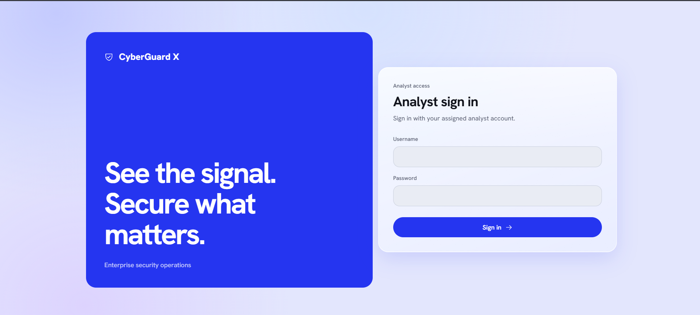
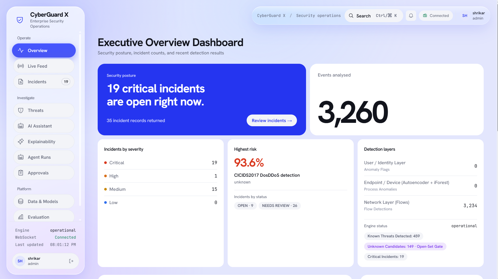
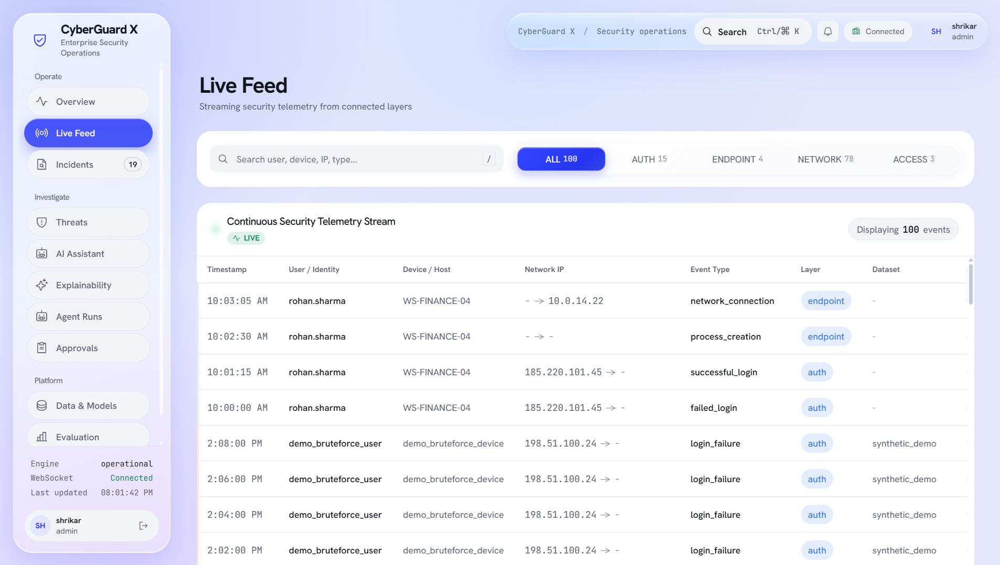
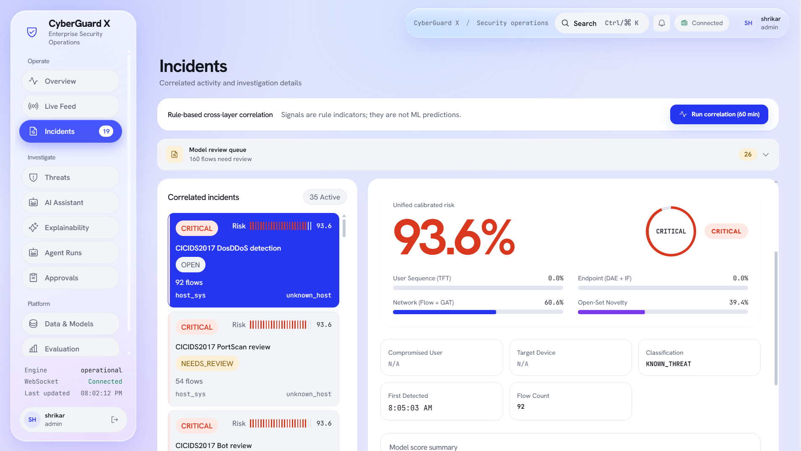
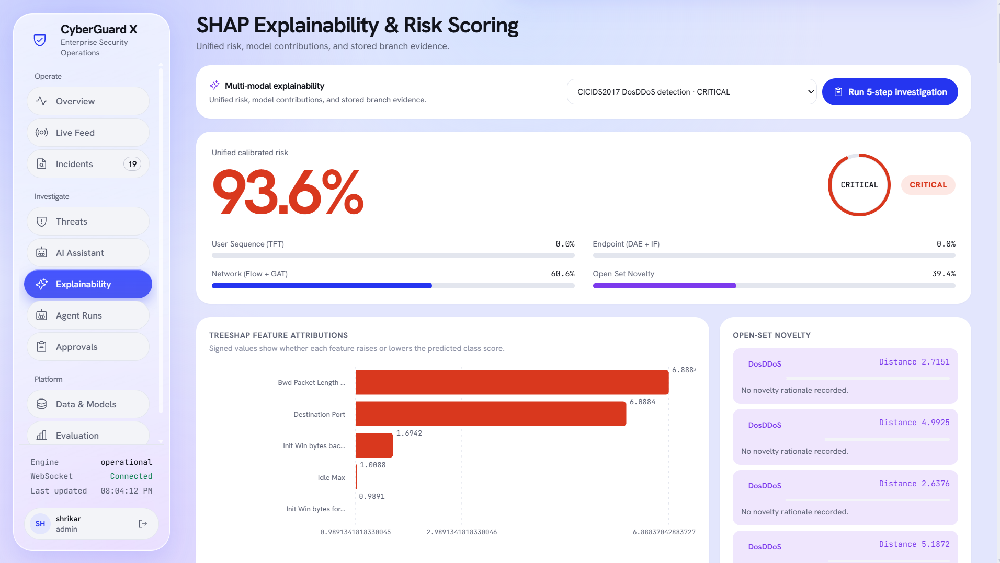
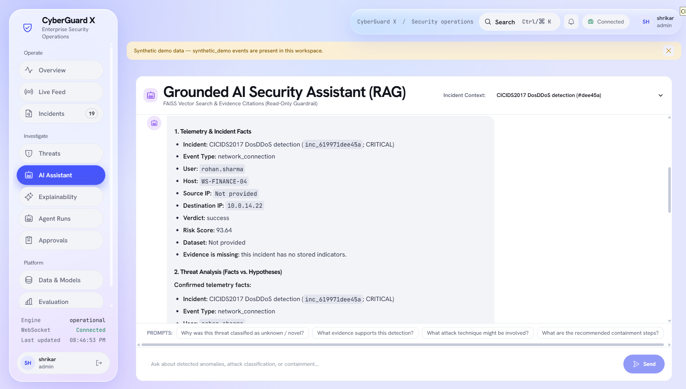
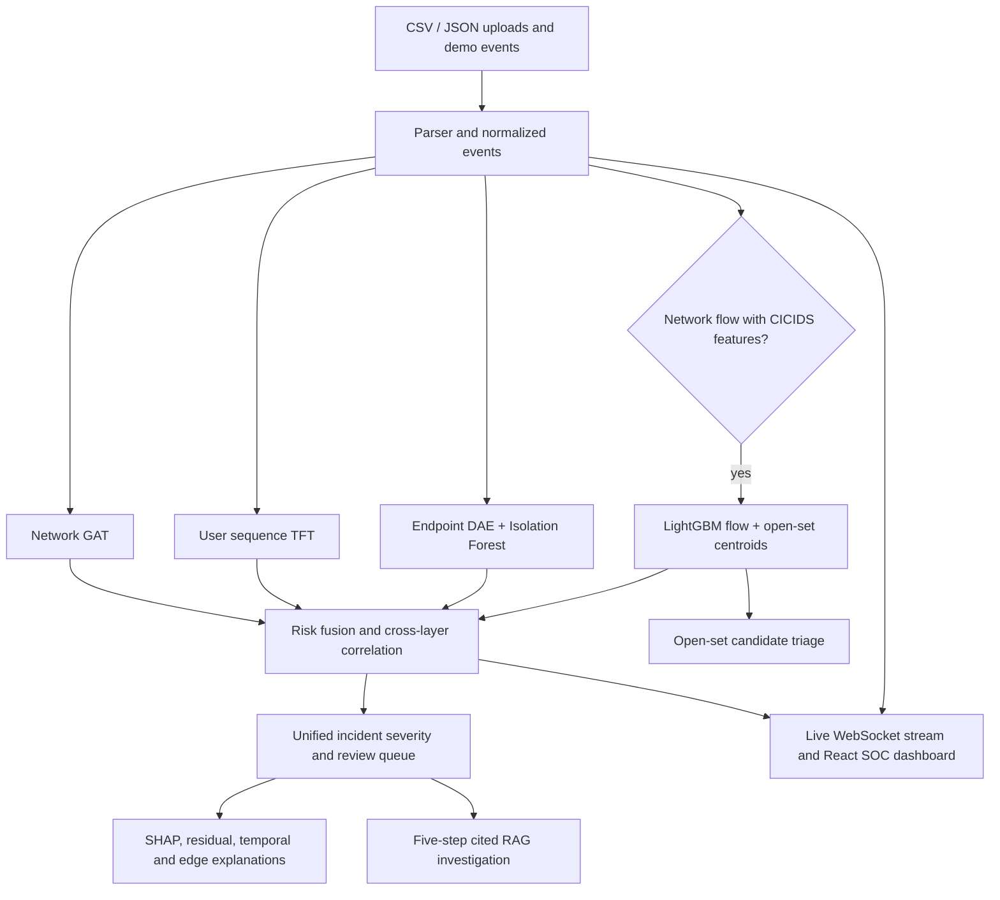

# CyberGuard X

**An explainable, multi-layer Security Operations Center (SOC) prototype that detects known attacks, flags novel (unknown) threats, and helps analysts investigate them with grounded, human-approved AI assistance.**

> B.Tech Information Technology, Final-Year Major Project, Vishwakarma Institute of Technology (VIT), Pune
>
> Author: Shrikar Bende | Academic year: 2026-27

---

## Table of contents

1. [Problem and motivation](#problem-and-motivation)
2. [What this project contributes](#what-this-project-contributes)
3. [System at a glance](#system-at-a-glance)
4. [Screenshots](#screenshots)
5. [Architecture](#architecture)
6. [Models and decision pipeline](#models-and-decision-pipeline)
7. [Implemented features](#implemented-features)
8. [Agentic investigation (opt-in)](#agentic-investigation-opt-in)
9. [Evaluation: what is measured and what is not](#evaluation-what-is-measured-and-what-is-not)
10. [Suggested demo walkthrough](#suggested-demo-walkthrough)
11. [Run locally](#run-locally)
12. [Docker deployment](#docker-deployment)
13. [Analyst accounts and permissions](#analyst-accounts-and-permissions)
14. [Tests](#tests)
15. [Limitations](#limitations)
16. [Tech stack](#tech-stack)

---

## Problem and motivation

Modern SOC teams face two recurring problems:

1. **Signature- and class-based detectors fail on novel attacks.** A classifier trained on known attack families has no principled way to say "this looks like nothing I have seen before."
2. **Alerts without explanations are hard to trust.** Analysts need to know *why* a flow or incident was scored high, and what to do next, without an AI taking uncontrolled action.

Enterprise CyberGuard X addresses both: it combines **known-threat classification with open-set (unknown) recognition**, fuses signals from **network, endpoint, user and host-graph layers**, and presents everything with **multi-modal explainability** and a **read-only, evidence-cited RAG assistant**.

## What this project contributes

| # | Contribution | Where to look |
|---|---|---|
| 1 | **Open-set network detection**: LightGBM flow classifier with confidence, energy/margin and compact-centroid rejection, so unfamiliar traffic is routed to `UNKNOWN_NOVEL` triage instead of being forced into a known class | [Latest open-set run](#latest-cicids-open-set-run) |
| 2 | **Multi-branch detection and risk fusion**: endpoint (DAE + Isolation Forest), user sequence (TFT), host graph (GAT) and a calibrated logistic fusion layer producing a severity tier with per-component contributions | [Models](#models-and-decision-pipeline) |
| 3 | **Explainability**: signed TreeSHAP attributions, risk-contribution bars, novelty distances, residual/temporal/edge explanations | [Screenshots](#screenshots) |
| 4 | **Grounded investigation**: five-step cited RAG workflow with evidence-gated MITRE ATT&CK mapping; optional bounded agent that can only *propose* actions for human review (dry-run) | [Agentic investigation](#agentic-investigation-opt-in) |
| 5 | **Honest evaluation methodology**: frozen session-disjoint holdout, multi-seed runs, bootstrap intervals, and explicit labelling of proxy-label results | [Evaluation](#evaluation-what-is-measured-and-what-is-not) |
| 6 | **Security-conscious engineering**: signed model artifacts, role-based access (viewer/analyst/admin), audit trail, no default accounts | [Accounts](#analyst-accounts-and-permissions) |

## System at a glance

| Item | Detail |
|---|---|
| Frontend | React SOC dashboard (Vite), live updates over WebSocket |
| Backend | FastAPI, SQLite (Alembic migrations), single-worker |
| ML | LightGBM, PyTorch (DAE, TFT, GAT), scikit-learn (Isolation Forest, logistic fusion), SHAP |
| Retrieval | FAISS-based RAG over a curated ATT&CK knowledge base (Enterprise ATT&CK v20.1 subset) |
| Primary dataset | CICIDS2017 (plus supplemental CSE-CIC-IDS2018 exploratory evaluation, Sysmon and UNSW-NB15 for secondary branches) |
| Safety stance | Read-only assistant; recommendations require human approval; agent approvals are dry-run only |

> **Evaluation status in one line:** the CICIDS2017 flow classifier and open-set detector are benchmarked against dataset labels; the endpoint, user-sequence, graph and fusion branches rely on proxy or synthetic labels. See [docs/RESULTS.md](docs/RESULTS.md).

## Screenshots

> Taken from a local development workspace with synthetic demo events and a held-out CICIDS2017 replay loaded. They illustrate the interface and are **not** evidence of detection performance.

### Analyst sign-in

Signed bearer-token login with `viewer`, `analyst` and `admin` roles. There is no default account; the first admin is created from the command line.



### Executive overview

Event totals per detection layer (user/identity, endpoint, network) alongside incident counts by severity and review status. Counts here come from the held-out CICIDS2017 replay plus synthetic demo scenarios, so they illustrate the layout rather than a real-world incident summary. Layers that receive no input for a flow replay (user/identity, endpoint) show 0 flags.



### Live telemetry stream

Events arrive over a WebSocket. The amber banner appears whenever `synthetic_demo` events are present: those are developer-written demo scenarios, not real attacks.



### Unknown / novel triage

Events outside known-class confidence or centroid boundaries, with centroid distance and novelty score. `UNKNOWN_NOVEL` means "needs analyst review", not a confirmed new attack.



### Explainability and risk scoring

Signed TreeSHAP feature attributions for the LightGBM flow classifier, the unified risk breakdown, and open-set novelty distances.



### RAG AI assistant

Read-only assistant with FAISS retrieval and cited evidence. It recommends steps for human approval and cannot execute actions.



## Architecture



## Models and decision pipeline

The codebase contains four trained model families:

| Branch | Algorithm | Role |
|---|---|---|
| Network flow | **LightGBM** (saved live model; training code also supports XGBoost) | Known-attack classification on CICIDS2017 flow features |
| Endpoint | **PyTorch denoising autoencoder + Isolation Forest** | Unsupervised endpoint behaviour anomaly scoring |
| User sequence | **Temporal Fusion Transformer (TFT)** | Weakly labelled user-activity sequence signals |
| Host communication | **Edge-aware Graph Attention Network (GAT)** | Host-to-host anomaly proxy scores |

Their outputs feed two decision layers:

- **Open-set checks:** centroid, energy and margin tests that decide whether a flow is a known class or should be escalated.
- **Risk fusion:** logistic-regression stacking that outputs a calibrated triage score and severity tier.

The flow classifier's persisted verdicts are `KNOWN_THREAT`, `UNKNOWN_CANDIDATE` and `UNKNOWN_NOVEL`; the detailed open-set `decision_outcome` can also report `ABSTAIN_NEEDS_REVIEW`. The fusion score is a **calibrated triage score, not a real-world incident probability**.

Model-family presence does not imply independently validated production performance; see [docs/RESULTS.md](docs/RESULTS.md).

## Implemented features

**Detection and ingestion**
- CSV and JSON ingestion with strict row validation, duplicate detection, optional CICIDS flow scoring, and background processing for large uploads.
- LightGBM CICIDS2017 flow classification with confidence, energy/margin, compact-centroid distance and calibrated open-set rejection (`attack_probability` is derived as `1 - P(BENIGN)`).
- Endpoint behaviour scoring (DAE + Isolation Forest), user-sequence scoring (TFT) and host-graph scoring (GAT).
- Calibrated logistic risk fusion combining user, endpoint, network, graph, open-set and correlation-stage signals.
- Rule-based user and endpoint indicators and cross-layer correlation (rules, not ML predictions).

**Analyst experience**
- SOC views for `UNKNOWN_NOVEL` triage, per-incident risk contributions, multi-modal explainability, and OSCR/recall/F1/AUPRC evaluation summaries.
- Grouped known-threat and unknown-candidate incidents with bounded sample-event evidence and probability-gated MITRE mappings.
- Live WebSocket updates, incident review queue, evaluation summary page, and held-out replay through the live engine.
- On-demand signed TreeSHAP explanations for supported CICIDS detections.

**Investigation**
- Read-only five-step RAG investigations (`retrieve → analyze → map → summarize → recommend`) with cited evidence, evidence-gated ATT&CK mapping and human-approval-only recommendations.
- Opt-in agentic investigation (see next section).
- Curated ATT&CK references versioned in `backend/app/rag/knowledge_metadata.json` against Enterprise ATT&CK v20.1 (verified 2026-11-19). This is a project-curated subset, not a complete synchronized catalog.

**Operations**
- Background retraining for the `light` and `medium` profiles; a completed artifact replaces its bundle atomically, and a failed job leaves the prior bundle in place.
- On-demand drift check (`POST /api/models/drift`, admin-only) computing feature-level PSI/KS from caller-supplied reference and current arrays. This is a caller-supplied comparison, **not** continuous live monitoring.
- Signed model artifacts with verification on load.

**Demo scenarios**
- Four interactive scenarios load by default (`multi_stage_takeover`, `brute_force_only`, `benign_admin`, `normal_employee_day`). `generate_all_taxonomy_scenarios()` supplies the twelve named synthetic threat scenarios plus two benign ones. These are developer-authored fixtures, **not** captured attack data or benchmark coverage.

## Agentic investigation (opt-in)

The agent investigates a selected incident through a bounded sequence of allowlisted tools and writes a report grounded in evidence returned during that run. The deterministic five-step RAG investigation is unchanged. Agent reports are advisory; this feature does not claim to improve detection or analyst outcomes.

**Safety design**
- Disabled by default (`AGENT_ENABLED=false`).
- Hard ceilings on steps, tool calls, wall time, result size and concurrency.
- Proposed actions are staged for human review; **approval is dry-run only and never executes a response**.
- By default the requester cannot approve their own proposal (including admins).
- Proposals for `RESOLVED` or `FALSE_POSITIVE` incidents cannot be approved.
- A local Ollama-compatible endpoint can keep requests inside the local environment (leave the API key blank).

**Status:** implemented; measured results are in [docs/agent/RESULTS.md](docs/agent/RESULTS.md). The default FakeLLM run measures plumbing and guard behaviour only, not real-model investigation quality.

<details>
<summary><strong>Configuration, routes, privacy and run states</strong></summary>

Enable with `AGENT_ENABLED=true`. Blank `AGENT_LLM_*` values inherit the corresponding `LLM_*` settings. Never put credentials in `.env.example` or tracked files.

| Setting | Default | Purpose |
|---|---:|---|
| `AGENT_ENABLED` | `false` | Opt in to agent endpoints. |
| `AGENT_TOOL_MODE` | `native` | Native provider tools, with JSON-mode fallback after an unsupported native request. |
| `AGENT_LLM_API_URL` | inherited / blank | OpenAI-compatible chat completions URL; URL-only local service is supported. |
| `AGENT_LLM_API_KEY` | inherited / blank | Provider key; optional for local URL-only models. |
| `AGENT_LLM_MODEL` | inherited / blank | Model name sent to the provider. |
| `AGENT_MAX_STEPS` | `6` | LLM turns; hard ceiling `12`. |
| `AGENT_MAX_TOOL_CALLS` | `12` | Tool calls; hard ceiling `30`. |
| `AGENT_WALL_SECONDS` | `90` | Run wall time; hard ceiling `300` seconds. |
| `AGENT_RESULT_CHARS` | `6000` | Per-tool result size; hard ceiling `20000` characters. |
| `AGENT_MAX_CONCURRENT_RUNS` | `2` | Concurrent runs; hard ceiling `4`, with one run per incident. |
| `AGENT_MAX_OUTPUT_TOKENS` | `1500` | Maximum provider output tokens per request. |
| `AGENT_EXECUTION_MODE` | `dry_run` | Only supported execution mode; approvals are simulated. |
| `AGENT_ALLOW_SELF_APPROVAL` | `false` | Demo-only opt-in for requester self-review. |
| `AGENT_PROPOSAL_TTL_HOURS` | `24` | Pending proposal lifetime before lazy expiry. |

**Permissions:** authenticated users can read configuration, run summaries/details and the proposal queue. Analysts and admins can start/cancel runs and approve or reject proposals.

**Routes:** `GET /api/agent/config`, `POST /api/incidents/{incident_id}/agent-investigate`, `GET /api/agent/runs`, `GET /api/agent/runs/{run_id}`, `POST /api/agent/runs/{run_id}/cancel`, `GET /api/agent/proposals`, `POST /api/agent/proposals/{proposal_id}/approve`, `POST /api/agent/proposals/{proposal_id}/reject`. Run details include the persisted step trace; run-list responses omit steps.

**Privacy:** the configured provider receives the system instructions, incident and event identifiers, and any evidence requested by the tools. Evidence can include user IDs and usernames, device IDs and hostnames, source/destination IPs, event type/category, process names, scenarios, URLs/URIs, command lines, file paths, raw-payload text excerpts, detector summaries and retrieved knowledge chunks. Only selected tools and fields are sent per run, but telemetry can contain sensitive operational data.

**Run states:** `completed`, `completed_fallback`, `limit_reached`, `failed`, `cancelled`. Fallback and limit-reached runs include the deterministic baseline. Run coordination is process-local, so the agent layer supports one backend worker only.

</details>

## Evaluation: what is measured and what is not

This project separates **benchmarked** results from **proxy-label** results so that no number is over-claimed.

| Branch | Label source | Evidence level |
|---|---|---|
| Network flow + open-set (LightGBM) | CICIDS2017 ground-truth labels | **Benchmarked** (multi-seed, leave-one-family-out) |
| User sequence (TFT) | Heuristic sequence labels | **Proxy-label validated** |
| Host graph (GAT) | UNSW-NB15 attack-category indicator | **Proxy-label validated** |
| Risk fusion | Synthetic weak labels | **Proxy-label validated** |
| Endpoint (DAE + IF) | Unsupervised, 293 Sysmon windows | No independent validation metrics |

### Evaluation methodology

- A **frozen, session-disjoint holdout**: the complete Monday CICIDS2017 capture is reserved in `backend/ml/evaluation/holdout_manifest.json`; the baseline runner verifies its hash but never loads or scores those rows.
- Development runs use seeds `42, 101, 202, 303, 404` and reserve complete capture sessions by attack family.
- Results are written as JSON artifacts with source hashes, split assignments, per-seed metrics and bootstrap intervals, then rendered into `docs/RESULTS.md`.

Reproduce from the repository root:

```powershell
python scripts/run_network_eval.py
```

(`python scripts/make_results_md.py` only re-renders the latest saved results; it does not run evaluation.)

### Latest CICIDS open-set run

Saved **medium profile, seed 42, 50% sample** report [`open_set_compact_margin97_medium_seed42.json`](backend/ml/evaluation/results/open_set_compact_margin97_medium_seed42.json), `confidence_energy_compact_union` detector, evaluated on held-out unknown attack families. This is one run, not a multi-seed estimate.

| Held-out attack family | OSCR AUC | Unknown recall | Known macro F1 | AUPRC |
|---|---:|---:|---:|---:|
| DoS/DDoS | 0.9528 | 0.7252 | 0.9428 | 0.8129 |
| PortScan | 0.8315 | 0.0255 | 0.9473 | 0.1026 |
| BruteForce | 0.9696 | 0.2836 | 0.9497 | 0.1060 |
| WebAttack | 0.9905 | 0.9352 | 0.9593 | 0.6307 |
| Bot | 0.7204 | 0.0000 | 0.9891 | 0.0029 |
| Macro mean (five families) | **0.8930** | **0.3939** | **0.9576** | **0.3310** |

**Reading:** separation is strong for WebAttack and DoS/DDoS. PortScan and Bot are weak because a scan or bot pattern is visible across flows from one host, not inside a single flow; host-window features targeting this gap are implemented but not yet consumed by the saved bundles.

### Capture-session generalization

Random row splits are optimistic for CICIDS2017 because near-duplicate flows from one capture session can land in both train and test. The saved comparison uses a medium profile (50% sample, seeds 42 and 43, 60,000-row training caps, confidence detector); see [`medium_stratified_vs_session_disjoint.md`](backend/ml/evaluation/results/medium_stratified_vs_session_disjoint.md).

| Split | OSCR AUC | Unknown recall | Benign FPR | Known macro F1 |
|---|---:|---:|---:|---:|
| Stratified random | 0.7992 (0.6555-0.9429) | 0.4743 (0.2369-0.7118) | 0.0298 (0.0288-0.0308) | 0.9467 (0.9363-0.9571) |
| Session-disjoint (sanitized features) | 0.5996 (0.2208-0.9785) | 0.1716 (0.0000-0.5055) | 0.0027 (0.0018-0.0036) | n/a |

The session-disjoint arm had held-out unknown support in only **3 of 10** family/seed folds, so its intervals are wide. The earlier session-disjoint known macro-F1 (0.1897) averaged across labels with zero test support, so it is not a valid support-aware score and is shown as n/a. No evaluation was rerun.

### Secondary-branch artifact estimates

| Branch | Data and split recorded in artifact | Estimate |
|---|---|---|
| Endpoint (DAE + IF) | Unsupervised on 293 Sysmon capture windows | No independent validation metrics stored |
| User sequence (TFT) | 1,978 train / 495 validation sequences; 24 steps; Sysmon/CERT weak labels; seed 42 | Proxy-label validated: ROC AUC 0.99998, accuracy 0.9960, precision 0.9926, recall 0.9926. These mostly show the model recovers the heuristic; they are not ground-truth performance. |
| Host graph (GAT) | 12,000 UNSW-NB15 rows; 1,148 positive; seed 42 | Proxy-label validated; no independent validation metrics stored |
| Risk fusion | 4,800 train / 1,200 validation weakly labelled rows | Proxy-label validated: ROC AUC 0.8573, Brier 0.1507. A calibration estimate, not an end-to-end incident benchmark. |

### RAG retrieval

| Suite | Questions | Hit@1 | Hit@3 | MRR |
|---|---:|---:|---:|---:|
| Original developer-written suite | 20 | 0.85 | 0.90 | 0.875 |
| Expanded suite (direct, adversarial, multi-hop) | 50 | 0.62 | 0.80 | 0.69 |

The suites differ in difficulty, so the drop is not a regression. The 50-case run also reports an extractive citation/ATT&CK-ID support score of 0.5602 (unsupported-assertion rate 0.4398), a narrow deterministic proxy for groundedness rather than a human-judged hallucination rate.

<details>
<summary><strong>Manifest-tracked multi-seed baseline (earlier detector set)</strong></summary>

<!-- GENERATED RESULTS: START -->
## Manifest-tracked multi-seed baseline

This generated table is the three-seed baseline for the earlier confidence/Isolation-Forest/Mahalanobis detector set. For the newer compact-centroid/energy detector's seed-42 metrics, see the latest run above.

Generated from completed JSON files in `backend/ml/evaluation/results/`. Means and population standard deviations are computed across saved seeds. Low support means fewer than 200 unknown test rows in at least one seed.

### medium (3 seeds)

| Family | Detector | AUROC mean ± sd | Unknown rejection mean ± sd | Seeds | Support |
|---|---|---:|---:|---:|---|
| Bot | confidence | 0.6755 ± 0.0546 | 0.1743 ± 0.0885 | 3 | ⚠ LOW SUPPORT (<200) |
| Bot | confidence_mahalanobis_rank_average | 0.6705 ± 0.0404 | 0.2335 ± 0.0124 | 3 | ⚠ LOW SUPPORT (<200) |
| Bot | isolation_forest | 0.6167 ± 0.0139 | 0.0203 ± 0.0110 | 3 | ⚠ LOW SUPPORT (<200) |
| Bot | mahalanobis | 0.6452 ± 0.0105 | 0.0372 ± 0.0024 | 3 | ⚠ LOW SUPPORT (<200) |
| Bot | union_conf_mahalanobis | 0.6173 ± 0.0662 | 0.1201 ± 0.1233 | 3 | ⚠ LOW SUPPORT (<200) |
| BruteForce | confidence | 0.9448 ± 0.0447 | 0.7494 ± 0.3529 | 3 | OK |
| BruteForce | confidence_mahalanobis_rank_average | 0.9509 ± 0.0173 | 0.5599 ± 0.2504 | 3 | OK |
| BruteForce | isolation_forest | 0.7851 ± 0.0075 | 0.0000 ± 0.0000 | 3 | OK |
| BruteForce | mahalanobis | 0.8302 ± 0.0012 | 0.0019 ± 0.0005 | 3 | OK |
| BruteForce | union_conf_mahalanobis | 0.9047 ± 0.0708 | 0.2610 ± 0.0168 | 3 | OK |
| DosDDoS | confidence | 0.9558 ± 0.0090 | 0.8104 ± 0.0084 | 3 | OK |
| DosDDoS | confidence_mahalanobis_rank_average | 0.9841 ± 0.0044 | 0.9588 ± 0.0082 | 3 | OK |
| DosDDoS | isolation_forest | 0.9590 ± 0.0025 | 0.8122 ± 0.0064 | 3 | OK |
| DosDDoS | mahalanobis | 0.9597 ± 0.0008 | 0.7972 ± 0.0064 | 3 | OK |
| DosDDoS | union_conf_mahalanobis | 0.9720 ± 0.0033 | 0.8307 ± 0.0118 | 3 | OK |
| PortScan | confidence | 0.8187 ± 0.0625 | 0.1170 ± 0.0655 | 3 | OK |
| PortScan | confidence_mahalanobis_rank_average | 0.8673 ± 0.0304 | 0.0561 ± 0.0197 | 3 | OK |
| PortScan | isolation_forest | 0.8083 ± 0.0154 | 0.0032 ± 0.0006 | 3 | OK |
| PortScan | mahalanobis | 0.7864 ± 0.0009 | 0.0079 ± 0.0011 | 3 | OK |
| PortScan | union_conf_mahalanobis | 0.7687 ± 0.0403 | 0.0347 ± 0.0205 | 3 | OK |
| WebAttack | confidence | 0.9894 ± 0.0048 | 0.9599 ± 0.0109 | 3 | OK |
| WebAttack | confidence_mahalanobis_rank_average | 0.9351 ± 0.0030 | 0.0309 ± 0.0221 | 3 | OK |
| WebAttack | isolation_forest | 0.6416 ± 0.0261 | 0.0123 ± 0.0175 | 3 | OK |
| WebAttack | mahalanobis | 0.7384 ± 0.0113 | 0.0324 ± 0.0038 | 3 | OK |
| WebAttack | union_conf_mahalanobis | 0.9949 ± 0.0005 | 0.9753 ± 0.0079 | 3 | OK |

<!-- GENERATED RESULTS: END -->

</details>

## Suggested demo walkthrough

A five-minute path through the system for a live presentation:

1. **Sign in** as an analyst (role-based access, no default account).
2. **Executive overview**: show layer totals and incident severity/status.
3. **Load a demo scenario** (e.g. `multi_stage_takeover`) or start the held-out CICIDS2017 **replay**, and watch events arrive in the **live feed**. Point out the amber `synthetic_demo` banner.
4. **Unknown / novel triage**: open an `UNKNOWN_NOVEL` event and explain centroid distance and novelty score.
5. **Explainability**: open a detection and show TreeSHAP attributions and the unified risk breakdown.
6. **RAG assistant**: run the five-step investigation on an incident and show cited evidence and the human-approval recommendation.
7. **(Optional) Agent**: with `AGENT_ENABLED=true`, run an agent investigation and show a staged proposal; approve it to demonstrate the dry-run-only guarantee.
8. **Evaluation page**: close on the honest results and limitations.

## Run locally

Requirements: Python 3.10+ and Node.js 18+.

**Backend** (from the repository root):

```powershell
python -m pip install -r backend/requirements.txt
cd backend
uvicorn app.main:app --host 127.0.0.1 --port 8000 --reload --no-proxy-headers
```

**Model artifact verification** is on by default (`ALLOW_UNSIGNED_MODELS=false`). On a fresh clone the bundles in `backend/saved_models/` are unsigned, so startup refuses to load them with a missing-manifest error unless you either:

- generate a key (`python -c "import secrets; print(secrets.token_hex(32))"`), set it as `ARTIFACT_HMAC_KEY`, and run `python scripts/sign_existing_models.py`, **or**
- set `ALLOW_UNSIGNED_MODELS=true` (local development only; logs a warning on every load).

See [docs/MODEL_ARTIFACT_SECURITY.md](docs/MODEL_ARTIFACT_SECURITY.md).

**Create the first admin** from `backend/`:

```powershell
python -m app.cli create_admin
```

(or set both `ADMIN_USERNAME` and `ADMIN_PASSWORD` for one-time startup setup; ignored once any account exists).

**Frontend** (second terminal):

```powershell
cd frontend
npm install
npm run dev
```

Open [http://localhost:5173](http://localhost:5173). The Vite dev proxy forwards `/api` and `/ws` to the backend. The API health URL is [http://127.0.0.1:8000/api/health](http://127.0.0.1:8000/api/health), API docs are at `/docs`, and live events use `ws://127.0.0.1:8000/ws/live-events`.

<details>
<summary><strong>Signing, registry, replay, retraining and database notes</strong></summary>

**Signing model bundles.** Configure `ARTIFACT_HMAC_KEY` (also accepted as `MODEL_ARTIFACT_HMAC_KEY`) with at least 32 random bytes, then from the repository root:

```powershell
python scripts/sign_existing_models.py --models-dir backend/saved_models
```

To record a signed version in the file-based registry:

```powershell
python scripts/model_registry.py register network_flow backend/saved_models/cicids2017_medium_lightgbm.bundle.pkl --version-id local-demo
```

The sign command writes manifests beside the bundles and does not alter model contents. Never use a public or demo key in a real deployment.

**Replay sample.** Prepare offline from the repository root:

```powershell
python backend/ml/training/make_replay_sample.py
```

This writes a stratified 3,000-row sample to `backend/datasets/replay/replay_sample.csv.gz`. Request replay from the UI or with `python backend/ml/training/replay_test_split.py --n 3000 --speed 10`.

**Retraining.** `POST /api/models/retrain` with `{"profile":"light"}` or `{"profile":"medium"}`; poll `/api/models/retrain/status/{job_id}`.

**Database.** The runtime supports **SQLite only**; non-SQLite `DATABASE_URL` values are rejected at startup (`backend/app/database/session.py`, with a regression test for PostgreSQL URLs). PostgreSQL runtime support is a planned Phase 5 upgrade; the separate staging-only recovery utility does not provide it. Schema changes are managed by Alembic (`alembic current`, `alembic upgrade head` from `backend/`). Existing databases are adopted only when tables and columns match the pre-auth baseline; a mismatch stops startup without dropping data. Back up before reviewing a migration.

Uvicorn access logs show the immediate proxy peer address; the application applies its configured trusted-proxy policy separately for login attribution.

</details>

## Docker deployment

1. Copy `.env.example` to `.env` and set a non-empty `SECRET_KEY` (the example includes a URL-safe hex generator).
2. Either set `ARTIFACT_HMAC_KEY` and sign the bundles, or set `ALLOW_UNSIGNED_MODELS=true` for local demonstration only.
3. For first startup on an empty database, either set `ADMIN_USERNAME` and `ADMIN_PASSWORD` for one-time bootstrap, or create the admin after startup.

```powershell
docker compose up --build
```

Open [http://localhost:3000](http://localhost:3000). The backend is bound to localhost:8000 and the frontend is published on port 3000 (it proxies `/api` and `/ws`; health check uses `/api/health`).

Compose stores the database at `/app/data/cyberguardx.db` in the named volume `cyberguardx_demo_sqlite_data`, and startup applies Alembic migrations automatically. **Do not use `docker compose down -v` if you want to keep the database.** The backend runs a **single Uvicorn worker**: upload, retrain, evaluation, replay, WebSocket, login-throttle and agent coordination state is process-local, so multiple workers or replicas are unsupported. See [docs/OPERATIONS.md](docs/OPERATIONS.md) for the operating boundary, concurrency results and backup/restore procedure.

## Analyst accounts and permissions

The API issues signed bearer tokens from `POST /api/auth/login`.

| Role | Capabilities |
|---|---|
| `viewer` | Read-only access |
| `analyst` | Update incident status, add notes, use RAG chat, analyze or upload telemetry, start/cancel agent runs, decide agent proposals |
| `admin` | Everything above, plus load/replay demos, run correlation, retrain models, run evaluations, run drift checks, manage accounts |

Admins create additional accounts with `POST /api/auth/users`. Login attempts, incident status changes and analyst notes are recorded in `analyst_activity`.

## Tests

Backend (from the repository root):

```powershell
python -m pytest backend/tests -v
```

Frontend (from `frontend/`):

```powershell
npm ci
npm test
npm run lint
npm run build
```

Application runtime and CI tests use SQLite.

## Limitations

> This is a research prototype, not production-validated threat detection.

- **Proxy labels:** the endpoint, user-sequence, graph and fusion branches use proxy or synthetic labels, so their metrics are not ground-truth performance.
- **Dataset scope:** each CICIDS2017 attack family appears on only one capture day, so per-family results are indicative only.
- **Weak unknown detection:** PortScan and Bot have low unknown recall because they only show up across multiple flows from one host.
- **No fusion ablation yet:** the benefit of combining branches has not been measured.
- **Single worker, SQLite only:** multi-worker and PostgreSQL support are planned.

**Next:** re-evaluate with host-window features, add a fusion ablation, and collect labelled endpoint data.

Full details and planned fixes: [docs/RESULTS.md](docs/RESULTS.md).


## Tech stack

**Backend:** Python, FastAPI, WebSockets

**Database:** SQLite (schema migrations with Alembic); PostgreSQL support planned

**ML / data:** LightGBM, XGBoost (training option), PyTorch, scikit-learn, SHAP, FAISS

**Frontend:** React, Vite

**DevOps:** Docker Compose, pytest, ESLint

**Datasets:** CICIDS2017, CSE-CIC-IDS2018, UNSW-NB15, Sysmon captures, CERT-style weak labels
