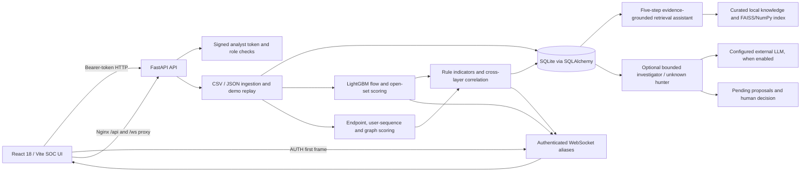

# CyberGuardX Engineering Baseline (Historical Snapshot)

Study date: 2026-11-26  
Scope: Phase 1 only. No source code, configuration, model, or database was modified. The requested build output was written to a temporary directory outside the repository.

This is a historical snapshot from 2026-11-26. Its PostgreSQL and deployment observations predate the current SQLite-only configuration and are not current operational guidance.

## Executive summary

CyberGuardX is a React/Vite SOC dashboard backed by a FastAPI service. The backend stores telemetry and analyst activity in SQLite through SQLAlchemy/Alembic, scores flows and related host/user evidence with saved ML bundles, correlates events into incidents, supports an evidence-focused retrieval assistant, and has a separate opt-in bounded investigation-agent layer. The architecture and major workflows are present, and the frontend production build succeeds.

The repository was already substantially modified before this study. The current branch is `fix/agent-review`, 18 commits ahead of `origin/master`; at study start, 59 tracked paths were modified and 21 paths were untracked. Those changes are preserved as user work. This report adds one new untracked documentation file. The working tree also contains an ignored `.env`, the SQLite database and its WAL sidecars, local datasets/model artifacts, and installed frontend dependencies. Secret values and database records were not read or reported.

The backend baseline is **192 passed, 7 skipped, 3 failed**. Two failures require an external LLM configured in the local environment and failed when the sandbox could not resolve its host; both passed when the external URL/key were blanked for the test process. The third failure is a WebSocket test double that lacks the first-frame `receive_text()` method required by the current authentication protocol. The frontend production build and Python syntax/import checks pass. `pip check` reports an installed OpenCV/NumPy version conflict. Compose validation cannot complete because its required PostgreSQL password variable is empty or unset.

Two directly verified security/reliability findings should be addressed before production exposure: the Compose file publishes PostgreSQL and the backend on all host interfaces, and login rate limiting trusts the first forwarded IP even though the Nginx proxy appends to a client-supplied `X-Forwarded-For`. The health route also returns a constant database-connected status without probing the database.

## Repository and Git state

- Branch: `fix/agent-review`; HEAD `09600bb` (`test(agent): add reproducible investigation evaluation`). It is 18 commits ahead of `origin/master`.
- Recent commits include bounded agent service/review hardening, opt-in investigation documentation, normalized result delimiter handling, and reproducible evaluation tests.
- At study start Git reported 59 changed tracked files and 21 untracked paths; the current count includes this new baseline report. Tracked changes span backend API, correlation, detection, ingestion, RAG, ML evaluation/preprocessing, and the frontend UI/build manifest. Pre-existing untracked work includes agent/RAG modules, evaluation output and tooling, tests, redesign docs, and frontend UI components/documentation.
- No changes were discarded, staged, reset, stashed, or overwritten. A post-check showed the same user changes still present.
- `.env`, `backend/cyberguardx.db`, saved models, datasets, and `frontend/node_modules` are ignored by Git. `.env` values were deliberately not inspected. The database was inspected only through a read-only SQLite connection for schema names and migration revision.
- Top-level project areas: `.github`, `backend` (app, Alembic migrations, tests, ML, datasets, saved models), `docs` (agent, redesign, results), `frontend` (React/Vite source, Docker/Nginx), `scripts`, screenshots, README, Compose and environment example.
- No `AGENTS.md` was found.

## Architecture map

### Runtime connections verified in code

1. `frontend/src/App.jsx` selects dashboard pages and `frontend/src/services/api.js` calls the API. The application stores the analyst bearer token in session storage and sends an `AUTH` WebSocket message in the first frame.
2. FastAPI middleware requires a valid bearer token for HTTP routes except login, health and preflight. Route dependencies further gate writes by analyst role. WebSocket aliases require a token in the first message.
3. Upload/demo flows normalize and deduplicate events, create related user/device rows, and score supported network events in a batch. Detection can use the saved flow classifier/open-set bundle and the saved endpoint, user sequence and graph bundles.
4. Correlation derives indicators and links related event layers into incidents; risk scores, explanations and analyst activity are persisted.
5. The deterministic RAG investigation reads incident evidence and local knowledge, producing cited recommendations. The separate agent integration is disabled by default, bounded by configured limits, uses read-only tools except for creating pending proposals, and records approvals as simulated rather than executing security actions.
6. SQLAlchemy supports SQLite. Alembic has three revisions from the initial baseline through analyst auth and agent persistence. Application lifespan runs migrations automatically at startup.
7. Compose runs backend and Nginx frontend. Nginx proxies `/api` and `/ws`; saved model bundles are mounted into the backend container.

## Feature inventory / preservation checklist

| Feature | Frontend | Backend / API | Data and dependencies | Tests / status |
|---|---|---|---|---|
| Analyst login, roles and account admin | `LoginScreen`, app session state | `/api/auth/login`, `/me`, `/users`; middleware and role dependencies | `analyst_accounts`, `analyst_activity`; signed HS256 tokens and PBKDF2 | `test_analyst_auth.py`, route metadata tests; implemented |
| Overview and dashboard statistics | `Overview` | `/api/dashboard/stats` | incidents, detections and events | API and UI feature tests; implemented |
| Live monitoring and streaming | `LiveMonitoring` | `/api/events`, `/api/alerts`; `/ws/live-events`, `/ws/stream`, `/ws/alerts` | in-process WebSocket manager | WebSocket auth test currently mismatches protocol fixture; workflow implemented |
| Threat intelligence / ATT&CK mapping | `ThreatIntelligence`, `MitreMatrix` | `/api/threats`; detection and correlation mapping | `mitre_techniques`, curated knowledge | detection/correlation tests; implemented with rule-based/demo thresholds |
| Incident queue and analyst workflow | `IncidentManagement` | `/api/incidents`, detail/status/notes, `/api/correlation/run` | incidents, event links, notes, activity | correlation, auth, endpoint tests; implemented |
| Explainability and multimodal risk | `Explainability`, `RiskFusion` | `/api/explainability/{incident_id}` | risk scores and branch evidence; SHAP where available | fusion tests; implemented, dependent on bundle/evidence availability |
| Evidence assistant / RAG | `AIAssistant`, `AssistantAnswer` | `/api/rag/chat`, incident investigation | local knowledge, Sentence Transformers, FAISS or NumPy; optional configured LLM | retrieval tests; deterministic path works; external LLM path is environment/network dependent |
| Data management, upload and replay | `DataManagement` | `/api/upload`, upload status, analyze, demo load/status/delete/replay/stop | events, dedup hashes, users/devices, datasets; 50 MB configured upload cap | upload/demo/parser tests; implemented; job registry is process-local |
| Detection and unknown triage | Overview/live/threat pages | detection engine and model status | flow LightGBM/open-set bundle plus endpoint/user/graph bundles | CICIDS, open-set, endpoint, sequence/graph tests; bundles present |
| Model retraining and evaluation | `Evaluation` | retrain/status, evaluation results/summary/run/status | saved model bundles, dataset files, JSON evaluation artifacts | retrain/evaluation tests; implemented, evaluation evidence varies by dataset/split |
| Optional investigation agents | `AgentRuns`, `ApprovalsQueue` | `/api/agent/*`, incident agent-investigate | additive `agent_runs`, `agent_steps`, `action_proposals`; configured LLM | agent suite; opt-in, bounded, proposals require human decision and only simulate execution |
| Navigation, command palette and visual system | `Sidebar`, `Header`, `CommandPalette`, shared UI/viz components | none | React 18, Tailwind, GSAP, Recharts, icons/fonts | production build passes; no frontend test or lint script is declared |

Database model inventory includes users, devices, security events, detection results, incidents, incident-event links, risk scores, investigation notes, ATT&CK techniques, analyst accounts/activity, agent runs/steps, and action proposals.

## Baseline checks

| Check | Result | Notes |
|---|---|---|
| Backend tests: `python -m pytest backend/tests -v` | **192 passed, 7 skipped, 3 failed** (202 collected) | See failures below. Tests use temporary databases; the working database was not migrated or reset. |
| RAG failures with `LLM_API_URL` and `LLM_API_KEY` blank for that process | **2 passed** | Confirms the two full-suite RAG failures were caused by the configured external LLM path being unavailable in this environment. No secret values were printed. |
| Python syntax: `python -m compileall -q backend/app backend/ml` | Passed | No syntax errors found. |
| Backend application import and route registration | Passed | `app.main` imports; 42 HTTP routes and 3 WebSocket routes registered. Lifespan was not invoked. |
| Alembic history | Passed | One head: `20261125_agent_layer`; no migration was executed. |
| Frontend production build | Passed | `npm run build -- --outDir <temporary-directory>`; Vite 5.4.21 transformed 5,214 modules. Existing `frontend/dist` was not overwritten. |
| Frontend lint | Not available | `frontend/package.json` defines only `dev`, `build`, and `preview`; no lint command exists. |
| Dependency check: `python -m pip check` | Failed | Installed `opencv-python 4.12.0.88` requires NumPy `<2.3.0`, but the environment has NumPy `2.3.2`. OpenCV is not listed in `backend/requirements.txt`; this is an environment mismatch to resolve only after confirming whether it is needed. |
| Frontend dependency tree: `npm ls --depth=0` | Completed | Declared dependencies resolve; local tree also reports `@fontsource-variable/manrope` as extraneous. It is not imported by current frontend source. |
| Compose config: `docker compose config --quiet` | Failed before validation | Required `POSTGRES_PASSWORD` is empty/unset. No secret value was printed. Containers were not started. |
| Existing DB read-only metadata | Passed | `backend/cyberguardx.db` contains expected application tables and `alembic_version=20261125_agent_layer`; DB/WAL/SHM were not changed. |
| Startup/API smoke check | Partial | Import/route registration passed. Full startup was intentionally not run because the lifespan automatically executes Alembic migrations and the prompt prohibits migration execution in Phase 1. |

### Test failures and skips

- `test_websocket_closes_unauthenticated_connections_with_4401` fails because its `FakeWebSocket` lacks `receive_text()`. Current code accepts the socket and awaits an `AUTH` first-frame message before closing unauthenticated sockets. This is a stale test double/protocol expectation; the failure alone does not establish a runtime WebSocket defect.
- `test_incident_without_indicators_says_evidence_is_missing` and `test_evidence_used_matches_values_stored_in_database` failed while trying to call the configured external LLM; name resolution was unavailable. Both passed with external LLM URL/key blanked for the test process.
- Seven skipped tests include Windows-incompatible socket/event-loop cases and an intentionally disabled-agent test. No skipped test is counted as passed.
- Warnings: the CICIDS tests identify stratified splitting when timestamps are unavailable as potentially optimistic due to session leakage; LightGBM emits a deprecation warning for `eval_set`.

## Confirmed findings and risks

### Security and production exposure

| ID / severity | Finding and evidence | Risk / proposed direction |
|---|---|---|
| SEC-01 / P1 | `docker-compose.yml` publishes PostgreSQL `5432:5432` and backend `8000:8000` without a loopback host address. Docker publishes on all host interfaces by default. | Database and API are directly reachable wherever the host firewall permits. Keep internal services on the Compose network and bind only intentionally public entry points; preserve a documented local-development path. |
| SEC-02 / P1 | `frontend/nginx.conf` forwards `$proxy_add_x_forwarded_for`, which appends to any client-supplied chain. `backend/app/api/auth.py` takes the **first** `X-Forwarded-For` value as the client IP. | A client can spoof the apparent address and evade per-IP login throttling/audit attribution. Derive client IP from a configured trusted proxy boundary or use the socket peer when no trusted proxy is present. |
| SEC-03 / P2 | Login caps and failures are held in process-local dictionaries in `backend/app/auth.py`; WebSocket connections and upload/evaluation job status are also process-local. Agent docs already state the agent registry requires a single backend worker. | State does not coordinate across workers or replicas and is lost on restart. Keep single-worker deployment documented or design shared state/rate limiting before scaling. |
| SEC-04 / P2 | The local `.env` is ignored and exists, but its contents were not inspected. No tracked `.env` is indicated by Git status/ignore checks. | Secret strength, rotation and possible credential exposure in archives cannot be confirmed from this Phase 1 inspection. A controlled secret audit is still needed; do not copy secrets into reports. |

### Reliability and deployment

| ID / severity | Finding and evidence | Risk / proposed direction |
|---|---|---|
| REL-01 / P1 | `/api/health` in `backend/app/main.py` returns `{"database":"connected"}` without using a database session or probing connectivity. Compose uses this route as the backend healthcheck. | A live API with a broken DB connection can remain marked healthy. Add a bounded DB health probe with a response contract compatible with current consumers and test DB-down behavior. |
| REL-02 / P1 | `backend/app/rag/assistant.py` invokes the configured LLM without handling request/network errors. Full-suite tests failed on network name resolution; the same two tests passed with the LLM unconfigured. | A remote provider outage can fail assistant requests instead of returning the deterministic extractive answer. Add an explicit bounded failure/fallback path and deterministic offline tests. |
| REL-03 / P2 | Compose configuration currently cannot validate because its required PostgreSQL password is empty/unset. Backend image installs from broad version ranges in `requirements.txt`; Docker frontend uses `npm install`. | Deployment is not presently reproducible from the current environment, and fresh builds can resolve newer transitive versions. Establish reproducible dependency inputs and validate Compose after secure values are supplied; do not print them. |
| REL-04 / P2 | `backend/app/main.py` applies migrations during lifespan startup. The database is at head today, but full application startup was not exercised to avoid touching it. | Deployment starts can modify persistent schema. Preserve backups and migration review; separate migration execution from app startup only if approved after compatibility analysis. |

### Performance, database, ML and RAG

- Uploads read at most the configured 50 MB plus one byte, then parse and process. Larger files move to daemon threads once they exceed 5,000 rows. A single request can therefore retain a large payload and concurrent uploads can increase memory use; no concurrency or throughput benchmark was run.
- Upload, replay, evaluation and WebSocket registries are in memory. They can disappear on restart and are not shared across worker processes. Agent docs explicitly limit that feature to one worker.
- RAG retrieval uses local Sentence Transformers and FAISS/NumPy. The test log reported a 12.39-second index build on one cold path; this is an observed single run, not a general latency benchmark. The local vector/index artifacts are present.
- The SQLite DB has WAL sidecars and is already at the latest migration. The newest agent migration is additive on upgrade, but its downgrade drops agent run/step/proposal tables and their persisted data. Any rollback plan must treat that as data-destructive and back up/export first.
- Flow, endpoint, user-sequence, graph and risk-fusion artifacts are present. CICIDS2017 is the main dataset-labeled evaluation basis; the repository's own results documentation identifies single-dataset, row-split/session leakage, weak Bot/PortScan unknown recall, proxy labels for auxiliary branches, and synthetic/demo correlation thresholds. These are validation limitations, not claims of measured production accuracy.
- RAG knowledge and saved indices exist. The deterministic assistant is evidence-focused; optional external LLM calls may transmit incident evidence to the configured endpoint. Provider data handling and deployment policy need explicit review. The opt-in agent remains disabled by default and proposals do not execute security actions.
- No migration was run; no database records or model artifacts were changed. Existing tests cover SQLite migration roundtrips, but there is no production PostgreSQL verification in this environment.

## Prioritized implementation plan (approval required)

Each item is a separate task. No implementation is authorized by this report.

### P1 — SEC-02: Trustworthy login client-IP attribution

- **Location/root cause:** `backend/app/api/auth.py` login; `frontend/nginx.conf` proxy headers. The app trusts the first forwarded value while the proxy appends to the incoming chain.
- **Proposed change:** Define an explicit trusted-proxy boundary and derive the client address only from trusted proxy metadata; retain direct-client behavior outside that boundary. Do not accept arbitrary client `X-Forwarded-For` as authoritative.
- **Files/dependencies:** likely `backend/app/api/auth.py`, `frontend/nginx.conf`, focused auth tests and deployment docs; no new dependency expected.
- **Risk/tests:** proxy topology and local direct requests must keep working. Test forged headers, trusted proxy requests, login throttling, audit attribution and existing auth roles. Rollback by reverting the focused code/config patch.

### P1 — SEC-01: Limit published Docker services

- **Location/root cause:** `docker-compose.yml` exposes the PostgreSQL and backend ports to all host interfaces.
- **Proposed change:** Keep database/backend internal to the Compose network by default, with deliberate loopback-only or override-based local access and an intentional frontend ingress. Document production exposure.
- **Files/dependencies:** `docker-compose.yml`, possibly Compose override/docs; no schema/dependency change.
- **Risk/tests:** local workflows and health dependencies must remain usable; run `docker compose config` with dummy non-secret values and verify service reachability/bind addresses. Rollback by reverting Compose-only edits.

### P1 — REL-01: Make health reflect DB availability

- **Location/root cause:** `backend/app/main.py::health` returns a constant DB status; Compose uses it as healthcheck.
- **Proposed change:** Perform a short bounded DB connectivity probe and return an accurate unavailable state/status while preserving the existing health response fields where possible.
- **Files/dependencies:** `backend/app/main.py`, API health tests, potentially Compose healthcheck only if response behavior changes.
- **Risk/tests:** startup/readiness behavior and local SQLite/PostgreSQL compatibility. Test connected and disconnected DBs plus existing public-health/auth behavior. Rollback by reverting the route/test patch.

### P1 — REL-02: Handle external RAG LLM failures

- **Location/root cause:** `backend/app/rag/assistant.py::_llm_answer` raises on external HTTP/DNS/provider errors, and the request path does not convert those to deterministic fallback output.
- **Proposed change:** Bound/handle provider failures and use the existing evidence-gated extractive answer with a clear provider/fallback marker; do not fabricate evidence or hide invalid configuration.
- **Files/dependencies:** `backend/app/rag/assistant.py`, RAG tests, possibly configuration docs.
- **Risk/tests:** preserve configured-provider success behavior, citations and evidence schema. Test timeout, DNS/HTTP error, malformed response, no-provider fallback and successful provider response without network. Rollback by reverting the scoped code/tests.

### P2 — SEC-03: Decide supported worker topology

- **Location/root cause:** login throttles and job/socket/agent state are process-local.
- **Proposed change:** For the immediate architecture, explicitly constrain/document one backend worker and add a deployment guard; evaluate shared storage/rate limiting as a separate future design if horizontal scaling is required.
- **Files/dependencies:** deployment docs/Compose or startup config and tests; a shared store would require a separately approved dependency and design.
- **Risk/tests:** changing worker count or state backend can affect concurrency and jobs. Verify current single-worker lifecycle and restart semantics; rollback is documentation/config guard revert.

### P2 — REL-03: Reproducible dependency and container build inputs

- **Location/root cause:** backend dependency ranges are broad and the installed environment has an OpenCV/NumPy conflict; frontend has lockfile but Docker uses `npm install`.
- **Proposed change:** First determine whether OpenCV is needed and reconcile environment constraints; then pin/lock runtime inputs without blanket upgrades.
- **Files/dependencies:** `backend/requirements.txt` and a lock/constraints file if selected; `frontend/Dockerfile`; tests/CI metadata as needed.
- **Risk/tests:** ML wheels and Python 3.11 container compatibility. Test installs/builds in the supported Python/container versions and compare lock resolution. Rollback by reverting dependency-input edits.

### P2 — REL-04 / DB: Migration lifecycle and rollback safety

- **Location/root cause:** automatic startup migrations and a downgrade that drops persisted agent tables.
- **Proposed change:** Document and exercise backup/restore and release migration procedures on a disposable DB copy; consider separating migration execution from API startup as its own design task. Never downgrade the current DB as a test.
- **Files/dependencies:** migration/deployment documentation and isolated migration tests; no live DB change.
- **Risk/tests:** migration locking, existing data preservation and SQLite/PostgreSQL differences. Use disposable copies for upgrade/downgrade tests. Rollback uses a verified backup/restore plan, not an assumed downgrade.

### P2 — PERF-01: Measure bounded upload and cold RAG behavior

- **Location/root cause:** bounded full-request buffers and observed cold index build; no concurrency/latency benchmark currently establishes headroom.
- **Proposed change:** Add measurements first for upload memory/latency, batch scoring and cold/warm retrieval before choosing an optimization.
- **Files/dependencies:** benchmark scripts/results only after an approved measurement task; preserve detection behavior and evidence quality.
- **Risk/tests:** measurements can consume CPU/memory; use synthetic/test data and avoid production DB. Rollback by removing only generated benchmark outputs if explicitly requested.

### P2 — ML/RAG evidence quality follow-up

- **Location/root cause:** documentation and saved metrics identify limited dataset coverage, possible session leakage, weak Bot/PortScan unknown detection, proxy labels and developer-written correlation thresholds; RAG quality uses authored suites and a deterministic support proxy.
- **Proposed change:** Plan reproducible held-out/session-disjoint and labeled evaluations, branch ablations, and human review of RAG support. Do not retrain or retune thresholds as part of baseline remediation.
- **Files/dependencies:** separate evaluation plans/data provenance and reports; no model artifacts changed.
- **Risk/tests:** external datasets/labels and review effort are prerequisites. Compare repeated seeds and report uncertainty. Rollback is report-only; do not replace existing models.

### P3 — TEST-01: Align WebSocket auth test with current protocol

- **Location/root cause:** `backend/tests/test_analyst_auth.py` fake socket does not implement the first-frame `AUTH` handshake in `backend/app/api/ws.py`.
- **Proposed change:** Update the test double and assertions to cover missing, malformed, expired and valid first-frame credentials plus timeout.
- **Files/dependencies:** test file only unless testing exposes a runtime issue.
- **Risk/tests:** preserve the documented first-frame token protocol and avoid query-string tokens. Run focused WebSocket/auth tests and existing frontend connection flow. Rollback by reverting test-only edits.

## Recommended implementation order

1. SEC-02 forwarded-IP trust boundary.
2. SEC-01 Docker host exposure.
3. REL-01 database-aware health check.
4. REL-02 deterministic fallback on external RAG provider failure.
5. TEST-01 WebSocket protocol fixture alignment.
6. REL-03 reproducible dependency inputs.
7. SEC-03 worker topology decision and guard.
8. DB migration backup/restore verification on disposable copies.
9. Measured performance and ML/RAG quality follow-ups.

No source or configuration changes are included in this phase. Await explicit approval before implementing any plan item.
