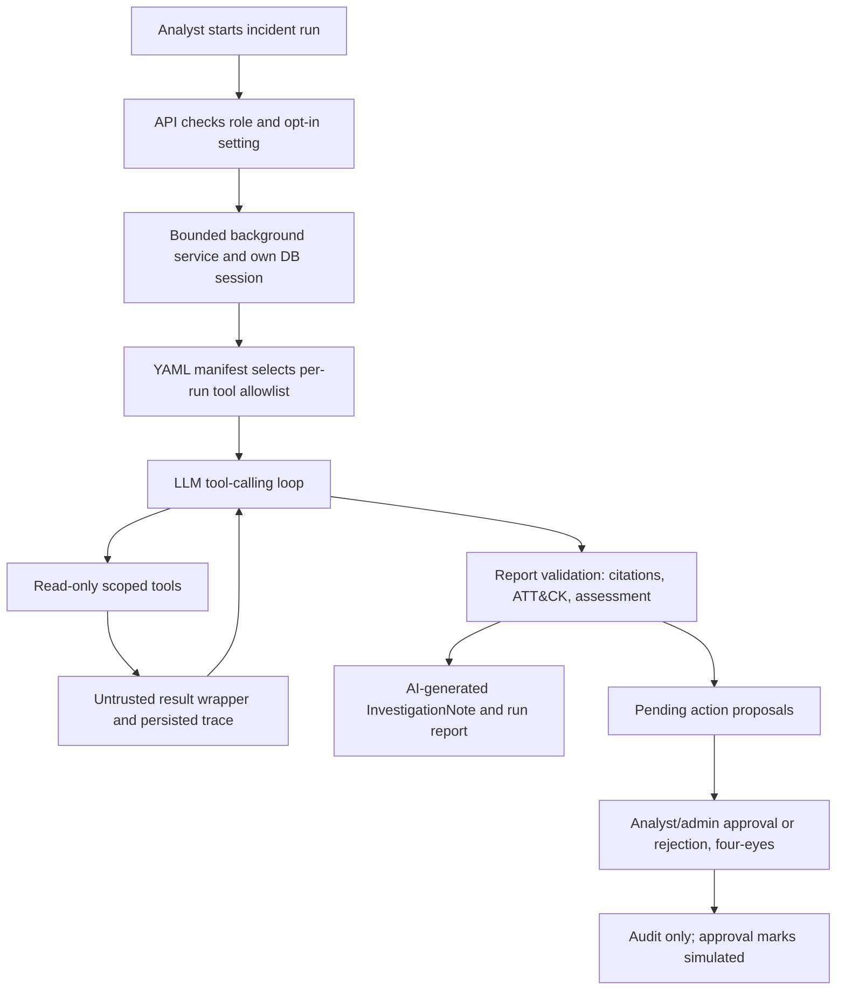

# Agentic investigation architecture

The agent is a separate, opt-in layer. The existing deterministic five-step RAG investigation remains unchanged. Agent endpoints other than `GET /api/agent/config` return 503 unless `AGENT_ENABLED=true`.

## Tools

| Tool | Scope and effect |
|---|---|
| `run_baseline_investigation` | Existing deterministic investigation; establishes this run's allowed chunks and ATT&CK techniques. |
| `get_incident_evidence` | Read-only incident and event evidence. |
| `get_explanation` | Read-only investigation evidence representation; the existing explainability endpoint can write a cache, so it is not called directly. |
| `get_detection_detail` | Scoped detector verdict, scores, and whitelisted details; no raw feature vectors. |
| `search_knowledge` | Bounded knowledge retrieval, including eligible resolved-incident documents. |
| `find_related_events` | Bounded query on verified event fields. |
| `get_correlated_incidents` | Related incident context from existing correlation data. |
| `list_unknown_candidates` | Bounded recent unknown detections, available to the unknown hunter. |
| `propose_action` | The only write tool; validates evidence and target, then inserts a pending proposal. |

Tool results are serialized and wrapped with `_untrusted("untrusted_tool_result", ...)` before they return to the model. The loop enforces the manifest allowlist, duplicate-call checks, incident scope, output truncation, and run limits. Worker updates are read by frontend polling.

Tool output truncation drops whole list entries and returns only evidence IDs that remain visible in the returned data. A valid citation proves that the evidence ID exists in this run's scope; it does not by itself prove that a report claim is supported by that evidence.

## Limits

Defaults are `AGENT_MAX_STEPS=6`, `AGENT_MAX_TOOL_CALLS=12`, `AGENT_WALL_SECONDS=90`, `AGENT_RESULT_CHARS=6000`, `AGENT_MAX_CONCURRENT_RUNS=2`, and `AGENT_MAX_OUTPUT_TOKENS=1500`. Hard ceilings are 12 steps, 30 tool calls, 300 seconds, 20,000 result characters, and 4 concurrent runs. A single incident may have only one active run. Per-call LLM timeout is capped at 45 seconds and the remaining run budget; transient HTTP failures retry up to three attempts with backoff and `Retry-After` support.

## Invariants

- **H1:** additive integration; existing deterministic endpoint behavior remains unchanged.
- **H2:** disabled by default; config remains readable while other agent endpoints return 503.
- **H3:** tools are read-only except pending proposal creation.
- **H4:** approval records a simulated execution state; no action is executed.
- **H5:** all tool output is untrusted data, including event fields.
- **H6:** claims without evidence IDs returned in this run are dropped and counted.
- **H7:** ATT&CK mappings must occur in the baseline map output and have run evidence.
- **H8:** report assessment has no confirmed value; incident status and analyst feedback are untouched.
- **H9:** agent tables use one additive Alembic migration; the legacy schema matcher excludes new tables.
- **H10:** step, tool, time, result-size, global concurrency, and per-incident limits are enforced.
- **H11:** unavailable or failed LLM/report paths return deterministic fallback output.
- **H12:** run, proposal, decision, and simulated-action audit events omit secrets.
- **H13:** evaluation numbers are generated by `scripts/eval_agent.py`; FakeLLM numbers describe plumbing only.

## Evaluation status

The scripted evaluation currently exercises 30 replay/demo inputs and 12 injection payloads. Demo inputs are synthetic. The generated metrics and provenance are in `docs/RESULTS.md` and the timestamped JSON artifact. No real-model quality or improvement claim is made; a real-model evaluation remains pending.
